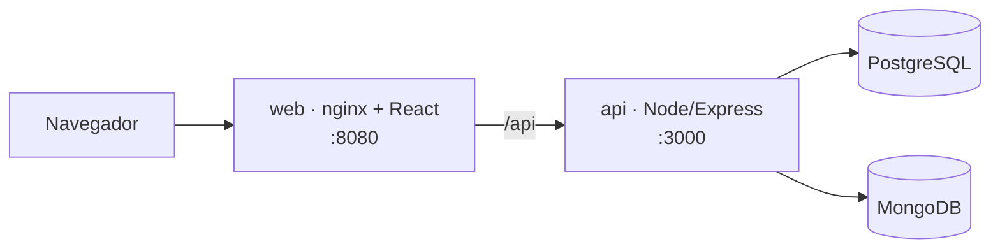

# 🎮 Cruzadinha Digital

Sistema educacional gamificado de **palavras cruzadas** para disciplinas de
Ciência da Computação (CEFET-RJ). Professores criam jogos cadastrando só as
respostas e as dicas, e o sistema monta a grade. Alunos encontram os jogos,
resolvem, recebem pontuação e entram no ranking. Um administrador mantém as
disciplinas.

O sistema vai rodar dentro da **Lúdica**, a central de jogos educacionais, que
fará a autenticação e enviará os usuários (`id, usertag, email, papel`).

**Objetivos:** tornar as atividades acadêmicas mais interativas, estimular a
aprendizagem com gamificação, facilitar a criação de atividades pelos
professores, permitir que os alunos pratiquem conteúdos de diferentes
disciplinas e disponibilizar dados de desempenho para acompanhamento.

---

## 🚀 Como rodar

Pré-requisito: Docker Desktop aberto.

```bash
docker compose up --build
```

Abra **http://localhost:8080** e, na tela de login, escolha um usuário de teste:

| Usuário | Perfil |
|---|---|
| `prof.carlos`, `prof.ana` | Professor |
| `aluno.bruno`, `aluno.duda`, `aluno.rafa` | Aluno |
| `admin.dcc` | Administrador |

A primeira subida já cria 4 cruzadas de exemplo e algumas partidas.
Para recomeçar do zero: `docker compose down -v && docker compose up --build`.

Mais detalhes (rodar sem Docker, testes, problemas comuns):
[docs/desenvolvimento.md](docs/desenvolvimento.md).

---

## 👥 O que cada perfil faz

### Professor
- **Cria jogos** informando título, disciplina (uma só — RN04), dificuldade,
  status e de **5 a 15 pares resposta + dica**. Ao salvar, o sistema **gera a
  grade automaticamente** e recusa se alguma palavra não encaixar.
- **Edita** jogos: se as palavras mudam, nasce uma **nova versão** e as
  partidas antigas continuam ligadas à versão jogada (RN09).
- **Publica** (só jogos publicados aparecem para os alunos), arquiva ou exclui
  (só jogos que ninguém jogou).
- Vê o **gabarito**, o **ranking** e as **partidas dos alunos** de cada jogo,
  e um painel com estatísticas.
- **Solicita disciplinas novas** ao administrador.

### Aluno
- **Busca jogos** por texto, código de acesso, disciplina e dificuldade.
- **Joga**: preenche a grade inteira e confere; o sistema diz **quantas**
  palavras estão certas (não quais). Confere quantas vezes quiser, até completar ou encerrar.
- Recebe **pontuação** pela tentativa em que acertou cada palavra, pela
  dificuldade e pelo tempo. Vê o gabarito no fim, o ranking e o histórico das
  próprias partidas. Pode jogar de novo.

### Administrador
- **Mantém as disciplinas** (criar, editar, desativar, excluir).
- **Aprova ou recusa** as solicitações de disciplina dos professores.

---

## 🧱 Stack

| Camada | Tecnologia |
|---|---|
| Front-end | React 18 + Vite + React Router (servido por nginx) |
| Back-end | Node.js + Express 5 — API REST em JSON |
| Bancos | **PostgreSQL** (usuários, disciplinas, cruzadas, versões, partidas) + **MongoDB** (palavras e grade de cada versão) |
| Infra | Docker Compose: `web`, `api`, `postgres`, `mongo` |



---

## 🗂️ Estrutura

```text
PalavrasCruzadas/
├── docker-compose.yml        postgres + mongo + api + web
├── docs/                     documentação (índice abaixo)
├── backend/                  API Node/Express
│   ├── db/postgres/          schema.sql, seed.sql
│   ├── db/mongo/             modelo da coleção conteudo_versao
│   ├── src/
│   │   ├── routes/           auth, cruzadas (professor, aluno, partida), disciplinas
│   │   ├── services/         regras de negócio, gerador de grade, pontuação
│   │   ├── db/               conexões Postgres e Mongo
│   │   ├── middleware/       sessão e papéis
│   │   └── regras.js         limites e tabela de pontuação
│   └── test/                 testes do gerador e da pontuação
└── frontend/                 React
    └── src/paginas/          Login, professor/, aluno/, admin/
```

---

## 📖 Documentação

**Manuais (entrega do checkpoint)** — em Word e Markdown: [docs/manuais/](docs/manuais/)

| Documento | Conteúdo |
|---|---|
| [Manual do Desenvolvedor](docs/manuais/manual-desenvolvedor.md) | Instalação do ambiente, diagrama de implantação, modelo lógico, API, deploy em produção, backup |
| [Manual do Usuário](docs/manuais/manual-usuario.md) | Uso por perfil com telas, diagramas de atividade e sequência, regras de negócio, perguntas frequentes |

**Análise e modelagem**

| Documento | Conteúdo |
|---|---|
| [Regras de negócio](docs/regras-e-casos-de-uso.md) | RN01–RN19, atores |
| [Casos de uso](docs/casos-de-uso.md) | Diagrama UC01–UC12 e especificação de cada um (pré/pós-condição, fluxo principal, alternativos, exceções) |
| [Diagramas](docs/diagramas.md) | Modelo de domínio (classes), estados (cruzada, partida, solicitação, disciplina), sequência dos fluxos principais, navegação entre telas |
| [Matriz CRUD](docs/matriz-crud.md) | Entidade × perfil, entidade × caso de uso, operação × rota |
| [Rastreabilidade](docs/rastreabilidade.md) | Cada RN → caso de uso, banco, API, tela e teste |

**Dados**

| Documento | Conteúdo |
|---|---|
| [Modelo de dados](docs/modelo-de-dados.md) | Diagrama ER do PostgreSQL, documento do MongoDB, por que dois bancos, o que mudou em relação ao modelo anterior |
| [Dicionário de dados](docs/dicionario-de-dados.md) | Tabela por tabela (e a coleção do Mongo): diagrama das relações, colunas, tipos, restrições, índices, domínios |

**Técnica**

| Documento | Conteúdo |
|---|---|
| [Arquitetura](docs/arquitetura.md) | Serviços, camadas do back-end, consistência entre os dois bancos, autenticação provisória, proteção das respostas, estrutura de pastas |
| [API](docs/api.md) | Todas as rotas, com corpos e respostas |
| [Gerador de grade](docs/gerador-de-grade.md) | Como o sistema monta a cruzadinha a partir das respostas |
| [Jogo e pontuação](docs/jogo-e-pontuacao.md) | Fluxo da partida, o que é registrado, fórmula de pontos, ranking |
| [Front-end](docs/frontend.md) | Telas por perfil, componentes, detalhes da tela de jogo |

**Projeto**

| Documento | Conteúdo |
|---|---|
| [Guia de desenvolvimento](docs/desenvolvimento.md) | Rodar, testar, usuários de teste, onde mexer, problemas comuns, fluxo de Git |
| [Histórico e decisões](docs/historico-e-decisoes.md) | O que cada sprint pediu e como foi atendido, decisões tomadas e pendências |

---

## 🌿 Branches e commits

```text
feature/*  →  dev  →  homolog  →  main
```

| Branch | Uso |
|---|---|
| `main` | Produção — só versões validadas; nada é feito direto nela |
| `homolog` | Homologação — valida o que veio da `dev` antes de ir para `main` |
| `dev` | Integração do desenvolvimento |
| `feature/*` | Uma funcionalidade por branch, criada a partir da `dev` e integrada por PR |

```bash
git checkout dev && git pull
git checkout -b feature/nome-da-funcionalidade
# ... commits ...
git push -u origin feature/nome-da-funcionalidade   # e abrir PR para a dev
```

Commits no padrão **Conventional Commits**: `feat:`, `fix:`, `docs:`, `test:`,
`refactor:`, `chore:`, `style:` (ex.: `feat: adiciona ranking por cruzada`).

---

## 🚧 Status

**Em desenvolvimento.** O fluxo completo funciona: o professor cria → o aluno
encontra e joga → pontuação, ranking e resultados para o professor.

- [x] Arquitetura e stack (React · Node/Express · PostgreSQL + MongoDB · Docker)
- [x] Usuários no formato do Lúdica (login simulado)
- [x] Criação e edição de jogos com versões
- [x] Geração automática da cruzadinha
- [x] Perfil administrador e manutenção de disciplinas
- [x] Solicitação de disciplina (professor → administrador)
- [x] Busca de jogos pelo aluno
- [x] Resolução da cruzadinha, pontuação e ranking
- [x] Resultados das partidas para o professor
- [ ] Integração real com o Lúdica (autenticação)
- [ ] Ambientes de homologação e produção

Decisões que ainda precisam ser validadas pelo grupo e pelo professor:
[docs/historico-e-decisoes.md](docs/historico-e-decisoes.md#registro-de-decisões).
