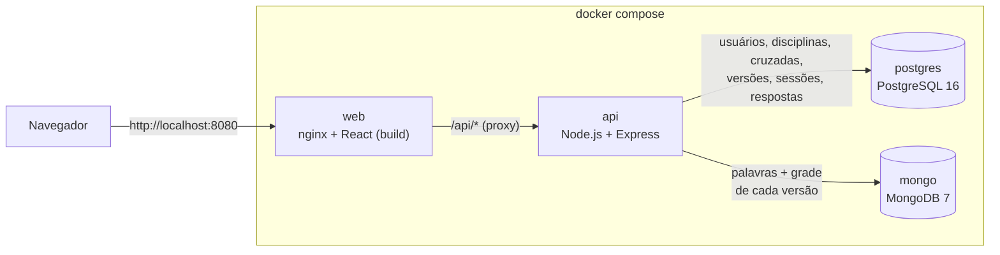
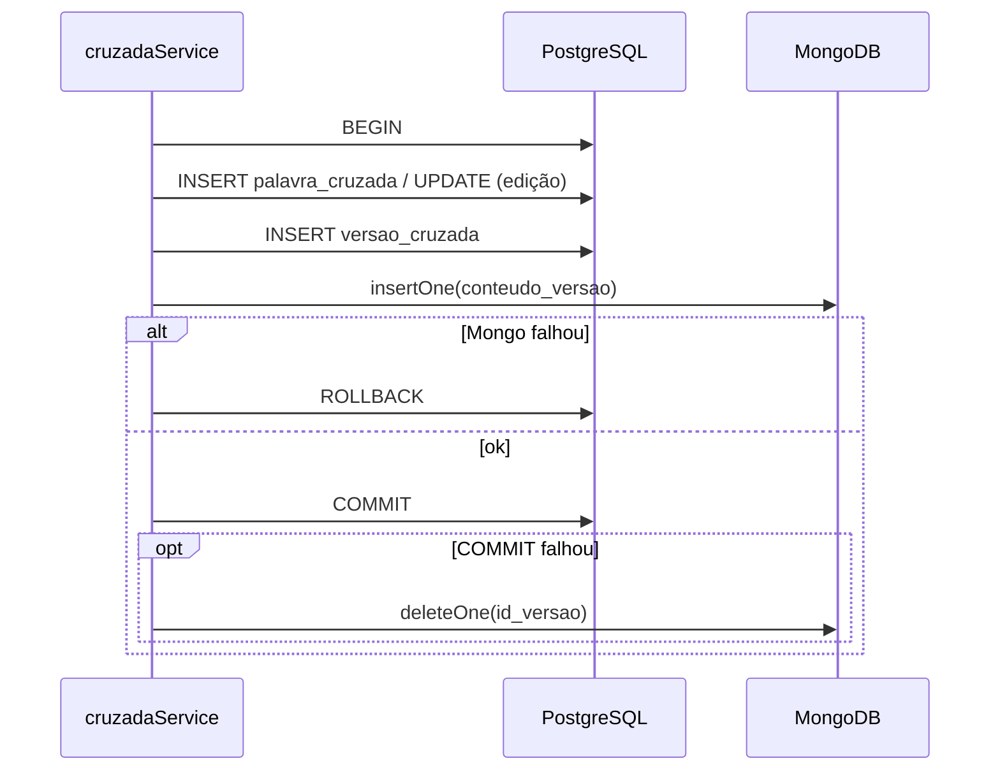

# Arquitetura

Visão de como o sistema está montado: quais peças existem, como conversam e
onde fica cada responsabilidade no código.

## Visão geral



| Serviço | Imagem / build | Porta no host | Papel |
|---|---|---|---|
| `web` | `frontend/Dockerfile` (build do Vite → nginx) | 8080 | Serve o React e repassa `/api/*` para a API |
| `api` | `backend/Dockerfile` (Node 22) | 3000 | API REST em JSON, regras de negócio |
| `postgres` | `postgres:16-alpine` | 5432 | Banco relacional |
| `mongo` | `mongo:7` | 27017 | Banco de documentos |

O navegador fala **só com o nginx** (mesma origem para página e API). Por isso
o cookie de sessão funciona sem configurar CORS. Em desenvolvimento o Vite faz
o mesmo papel com o `proxy` de `frontend/vite.config.js`.

## Stack

| Camada | Tecnologia | Por quê |
|---|---|---|
| Front-end | React 18 + Vite + React Router 6 | Pedido na Sprint 3 |
| Back-end | Node.js + Express 5 (ES Modules) | Já estava em Node na Sprint 2. O Express 5 trata erro de função `async` sem precisar de wrapper |
| Banco relacional | PostgreSQL 16 (`pg`) | Integridade (FKs, `CHECK`) e consultas agregadas (painel, ranking) |
| Banco de documentos | MongoDB 7 (driver oficial `mongodb`) | Conteúdo imutável de cada versão, lido inteiro (ver [modelo-de-dados.md](modelo-de-dados.md)) |
| Sessão | `express-session` (cookie `cruzadinha.sid`) | Login simulado enquanto a integração com o Lúdica não existe |
| Testes | `node:test` (nativo do Node) | Sem dependência extra |
| Infra | Docker Compose | Exigência desde a Sprint 1 |

## Back-end em camadas

```
requisição → app.js (sessão, carregarUsuario) → routes/* (exigirPapel) → services/* → db/postgres.js | db/mongo.js
                                                                              ↓
                                         erro de negócio (ErroNegocio) → handler em app.js → { erro, erros } + status
```

| Camada | Arquivos | Faz | Não faz |
|---|---|---|---|
| **Entrada** | `server.js`, `app.js` | Conecta no Mongo, roda o seed, monta o Express, a sessão, `/api/health`, `/api/regras` e o tratamento de erros | Regra de negócio |
| **Rotas** | `routes/auth.js`, `routes/cruzadas.js`, `routes/disciplinas.js` | Lê parâmetros, checa o papel (`exigirPapel`), chama o service e devolve JSON | SQL ou validação de negócio |
| **Middleware** | `middleware/auth.js` | `carregarUsuario` põe o usuário da sessão em `req.usuario`. `exigirPapel(...)` responde 401/403 | — |
| **Services** | `services/*.js` | Regras de negócio, validação, transações, gravação nos dois bancos | Conhecer `req`/`res` |
| **Lógica pura** | `services/gerador.js`, `services/pontuacao.js` | Gerar a grade e calcular pontos, sem banco. São as partes cobertas por teste unitário | I/O |
| **Acesso a dados** | `db/postgres.js`, `db/mongo.js` | Pool + `withTransaction`; conexão e coleção com `$jsonSchema` | — |
| **Configuração de regras** | `regras.js` | Limites (5–15 palavras, letras, dica), papéis, dificuldades e a tabela de pontuação | — |

### Services

| Service | Responsabilidade | RNs |
|---|---|---|
| `usuarioService` | Upsert do usuário vindo do Lúdica, listar e obter | RN01 |
| `disciplinaService` | Manter Disciplina, solicitações (professor → admin) | RN15, RN16 |
| `cruzadaService` | Criar, editar (com versão), excluir; gravação Postgres + Mongo; painel do professor | RN02–RN09, RN13, RN14 |
| `gerador` | Validar as palavras e gerar a grade automaticamente | RN06, RN13, RN14 |
| `jogoService` | Busca do aluno, tabuleiro sem respostas, ranking, partidas para o professor | RN11, RN17 |
| `sessaoService` | Partida: iniciar/retomar, conferir, encerrar | RN10, RN12, RN18 |
| `pontuacao` | Cálculo de pontos | RN19 |
| `erros` | `ErroNegocio` e atalhos (`validacao` 422, `naoEncontrado` 404, `proibido` 403, `conflito` 409) | — |

### Erros

Os services lançam `ErroNegocio` com status e lista de mensagens. O handler em
`app.js` converte em:

```json
{ "erro": "Verifique os dados informados.", "erros": ["O jogo deve ter entre 5 e 15 palavras (informadas: 4)."] }
```

O front mostra `erro` em negrito e `erros` como lista (componente `Erro`).
Qualquer outro erro vira 500 e é logado no console da API.

## Dois bancos: quem guarda o quê

Detalhes e diagrama em [modelo-de-dados.md](modelo-de-dados.md). Resumo:

- **PostgreSQL**: quem, quando e quanto. Usuários, disciplinas, solicitações,
  cabeçalho das cruzadas, versões, sessões de jogo e cada resposta enviada.
- **MongoDB**: o conteúdo do jogo. Coleção `conteudo_versao`, com um documento
  por versão contendo as palavras (resposta, dica, posição) e o tamanho da grade.
- **Ligação:** `versao_cruzada.id_versao` (Postgres) = `conteudo_versao.id_versao` (Mongo).

### Consistência sem transação distribuída

Ao salvar uma versão (`salvarComNovaVersao` em `cruzadaService.js`):



Excluir uma cruzada apaga as versões no Postgres (`ON DELETE CASCADE`) e depois
os documentos com aquele `id_cruzada` no Mongo.

## Autenticação (provisória)

O sistema vai rodar **dentro do Lúdica**, que fará a autenticação e enviará
`id, usertag, email, papel`. Como essa integração ainda não foi definida:

- `POST /api/auth/entrar` permite "entrar como" um usuário já cadastrado;
- `POST /api/auth/ludica` simula o Lúdica enviando o payload (faz *upsert* e loga);
- a sessão guarda só `idUsuario`; `carregarUsuario` busca o usuário a cada requisição.

**Para integrar de verdade**, basta trocar `carregarUsuario` em
`backend/src/middleware/auth.js` para ler o usuário de um token ou cabeçalho do
Lúdica (fazendo o upsert com `sincronizarUsuarioLudica`). Rotas e services não mudam.

> A sessão usa o armazenamento em memória padrão do `express-session`. Se o
> container da API reiniciar, todo mundo precisa entrar de novo. Para
> desenvolvimento isso não é problema.

## Segurança das respostas (RN11)

- O aluno **nunca** recebe o campo `resposta` enquanto a partida está aberta.
  `montarTabuleiro` (jogoService) manda só a grade vazia, números, dicas, posição e tamanho.
- A conferência roda **no servidor**. O navegador envia o que o aluno digitou e
  recebe só `{ tentativa, certas, total, concluida }`.
- O gabarito só vem em `GET /api/sessoes/:id` depois que a partida é encerrada.
- O detalhe com gabarito do professor (`GET /api/professor/cruzadas/:id`) só
  responde ao **autor**.
- O tempo da partida é calculado pelo Postgres (`CURRENT_TIMESTAMP - inicio`),
  não pelo cronômetro do navegador.

## Estrutura de pastas

```text
PalavrasCruzadas/
├── docker-compose.yml              4 serviços: postgres, mongo, api, web
├── README.md                       porta de entrada
├── docs/                           esta documentação
├── Jogo de Palavras Cruzadas …docx documento inicial da disciplina (v1)
│
├── backend/
│   ├── Dockerfile · .env.example · package.json
│   ├── db/
│   │   ├── postgres/schema.sql     tabelas, CHECKs, índices (roda na 1ª subida)
│   │   ├── postgres/seed.sql       usuários, disciplinas, 1 solicitação
│   │   └── mongo/modelo.md         modelo da coleção conteudo_versao
│   ├── src/
│   │   ├── server.js               entrada: Mongo → seed → listen
│   │   ├── app.js                  Express, sessão, /api, erros
│   │   ├── regras.js               limites e tabela de pontuação
│   │   ├── seedExemplos.js         4 cruzadas + 3 partidas de exemplo
│   │   ├── db/                     postgres.js, mongo.js
│   │   ├── middleware/auth.js      sessão e papéis
│   │   ├── routes/                 auth.js, cruzadas.js, disciplinas.js
│   │   └── services/               regras de negócio (tabela acima)
│   └── test/                       gerador.test.js, pontuacao.test.js
│
└── frontend/
    ├── Dockerfile · nginx.conf · vite.config.js · index.html
    └── src/
        ├── main.jsx                rotas
        ├── Sessao.jsx              usuário logado, regras, <Protegida>
        ├── api.js                  fetch + ErroApi
        ├── estilo.css              tema (paleta do protótipo)
        ├── componentes/            Layout, comuns (Grade, Ranking, Erro…)
        └── paginas/                Login, professor/, aluno/, admin/
```

Documentação de cada parte: [api.md](api.md) · [frontend.md](frontend.md) ·
[gerador-de-grade.md](gerador-de-grade.md) · [jogo-e-pontuacao.md](jogo-e-pontuacao.md).
