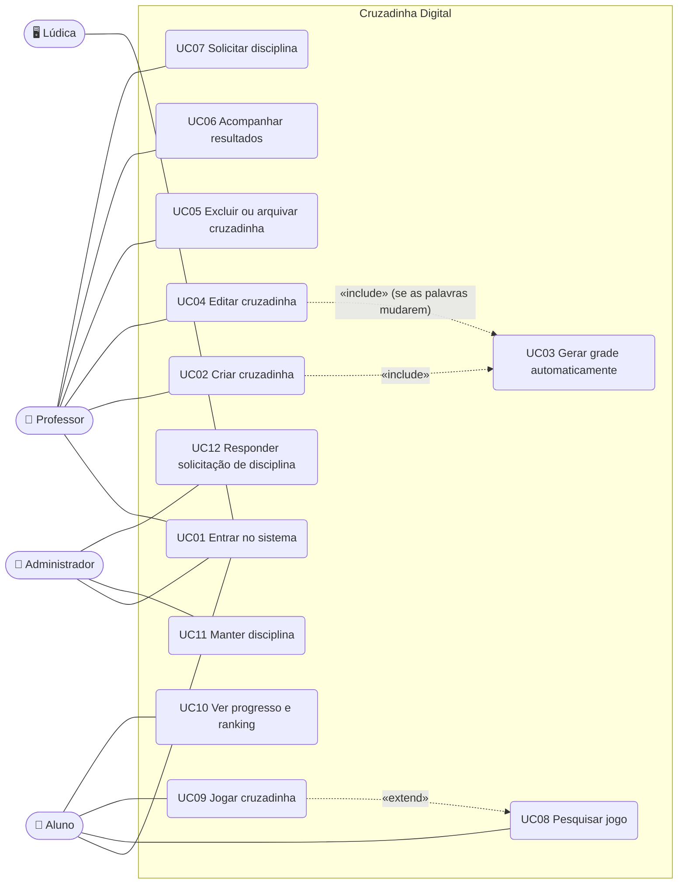

# Casos de uso

Diagrama e especificação de cada caso de uso, do jeito que está implementado.
Regras de negócio citadas (RNxx): [regras-e-casos-de-uso.md](regras-e-casos-de-uso.md).

## Atores

| Ator | Descrição |
|---|---|
| **Professor** | Cria e mantém as próprias cruzadinhas e acompanha os resultados |
| **Aluno** | Pesquisa e resolve cruzadinhas e acompanha seu desempenho |
| **Administrador** | Mantém as disciplinas e responde às solicitações dos professores |
| **Lúdica** (sistema externo) | Autentica os usuários e envia `id, usertag, email, papel`. Hoje é simulado |

## Diagrama

| UC | Nome | Ator | Tela | Rotas principais |
|---|---|---|---|---|
| UC01 | Entrar no sistema | todos / Lúdica | `/login` | `POST /auth/entrar`, `POST /auth/ludica` |
| UC02 | Criar cruzadinha | Professor | `/professor/nova` | `POST /professor/cruzadas` |
| UC03 | Gerar grade automaticamente | (sistema) | — | dentro de UC02/UC04 |
| UC04 | Editar cruzadinha | Professor | `/professor/cruzadas/:id/editar` | `PUT /professor/cruzadas/:id` |
| UC05 | Excluir ou arquivar cruzadinha | Professor | detalhe / edição | `DELETE` ou `PUT` com `status: arquivado` |
| UC06 | Acompanhar resultados | Professor | `/professor`, `/professor/cruzadas/:id` | `GET /professor/cruzadas[/:id]` |
| UC07 | Solicitar disciplina | Professor | `/professor/solicitacoes` | `POST /solicitacoes` |
| UC08 | Pesquisar jogo | Aluno | `/jogos` | `GET /jogos` |
| UC09 | Jogar cruzadinha | Aluno | `/jogos/:id` → `/partida/:id` | `POST /jogos/:id/sessoes`, `POST /sessoes/:id/conferir`, `POST /sessoes/:id/dica`, `POST /sessoes/:id/encerrar` |
| UC10 | Ver progresso e ranking | Aluno | `/jogos/:id`, resultado da partida | `GET /jogos/:id`, `GET /sessoes/:id` |
| UC11 | Manter disciplina | Administrador | `/admin/disciplinas` | `GET/POST/PUT/DELETE /disciplinas` |
| UC12 | Responder solicitação | Administrador | `/admin/solicitacoes` | `POST /solicitacoes/:id/responder` |

---

## UC01 — Entrar no sistema

| | |
|---|---|
| **Atores** | Professor, Aluno, Administrador; Lúdica |
| **Pré-condição** | — |
| **Pós-condição** | Sessão aberta; usuário levado à tela inicial do seu papel |
| **RNs** | RN01 |

**Fluxo principal (provisório, enquanto o Lúdica não está integrado)**
1. O usuário abre o sistema e é levado para `/login`.
2. O sistema lista os usuários já sincronizados, agrupados por papel.
3. O usuário escolhe um e clica em **Entrar**.
4. O sistema abre a sessão e redireciona: professor → painel, aluno → busca de jogos, administrador → disciplinas.

**Fluxo alternativo A1 — usuário novo vindo do Lúdica**
3a. O usuário preenche `id, usertag, nome, email, papel` em "Simular payload do Lúdica".
3b. O sistema cria o usuário, ou atualiza se o `id` já existir, e segue no passo 4.

**Exceção E1** — payload inválido (papel fora da lista, campos vazios): mensagens de erro e nada é gravado.

> **Futuro:** o Lúdica autentica e o sistema só lê o usuário do token
> (`middleware/auth.js`). Os passos 2 e 3 deixam de existir.

---

## UC02 — Criar cruzadinha

| | |
|---|---|
| **Ator** | Professor |
| **Pré-condição** | Logado como professor; existe ao menos uma disciplina ativa |
| **Pós-condição** | Cruzada criada com código de acesso e versão 1 (cabeçalho no Postgres, palavras e grade no Mongo) |
| **RNs** | RN02, RN04, RN05, RN06, RN07, RN13, RN14 |

**Fluxo principal**
1. O professor clica em **Novo jogo**.
2. Informa título, descrição (opcional), **uma** disciplina, dificuldade e status.
3. Cadastra de 5 a 15 pares **resposta + dica**. Começa com 5 linhas e pode adicionar ou remover.
4. Clica em **Salvar e gerar grade**.
5. O sistema valida os dados e executa o **UC03**.
6. O sistema gera o código de acesso (`<disciplina>-<5 dígitos>`), grava a cruzada e a versão 1 e mostra o detalhe com a grade montada.

**Fluxos alternativos**
- **A1 — disciplina não existe:** o professor segue o link "Solicite ao administrador" (UC07).
- **A2 — rascunho:** com status `rascunho`, o jogo não aparece para os alunos até ser publicado (UC04).

**Exceções** (o formulário volta com a lista de erros e nada é gravado)
- **E1** — menos de 5 ou mais de 15 palavras; resposta fora de 2 a 20 letras; dica vazia; resposta repetida.
- **E2** — título vazio, disciplina desativada ou inexistente.
- **E3** — a grade não pode ser montada (UC03, E1).

---

## UC03 — Gerar grade automaticamente

| | |
|---|---|
| **Ator** | Sistema (incluído por UC02 e UC04) |
| **Pré-condição** | Palavras já validadas |
| **Pós-condição** | Cada palavra tem linha, coluna, direção e número; a grade tem um tamanho |
| **RNs** | RN06, RN14 |

**Fluxo principal**
1. Normaliza as respostas (maiúsculas, sem acento).
2. Posiciona as palavras cruzando letras iguais, em várias ordens diferentes, e escolhe o resultado mais compacto em que todas couberam.
3. Numera os inícios de palavra e devolve a grade.

**Exceção E1** — alguma palavra não cruza com nenhuma outra: o salvamento é
recusado com "Não foi possível encaixar: …".

Detalhes do algoritmo: [gerador-de-grade.md](gerador-de-grade.md).

---

## UC04 — Editar cruzadinha

| | |
|---|---|
| **Ator** | Professor **autor** |
| **Pré-condição** | A cruzada existe e é do professor logado |
| **Pós-condição** | Cabeçalho atualizado; se as palavras mudaram, nova versão com grade nova |
| **RNs** | RN03, RN08, RN09 |

**Fluxo principal**
1. No detalhe da cruzada, o professor clica em **Editar**.
2. O sistema mostra o formulário preenchido.
3. O professor altera os dados e/ou as palavras e salva.
4. O sistema valida como no UC02.
5. **Se as palavras mudaram** (resposta ou dica, na ordem): executa o UC03 e cria a versão `n+1`. As partidas já jogadas continuam ligadas à versão antiga.
6. O sistema mostra o detalhe com o aviso "Nova versão vN gerada".

**Fluxos alternativos**
- **A1 — só mudou cabeçalho** (título, descrição, dificuldade, disciplina, status): atualiza sem criar versão.
- **A2 — publicar / arquivar:** é uma edição de `status` (A1).

**Exceções**
- **E1** — outro professor tenta editar: 403.
- **E2** — validação ou grade como no UC02.

---

## UC05 — Excluir ou arquivar cruzadinha

| | |
|---|---|
| **Ator** | Professor **autor** |
| **Pré-condição** | A cruzada é do professor logado |
| **Pós-condição** | Cruzada removida dos dois bancos, ou arquivada |
| **RNs** | RN03, RN09, RN12 |

**Fluxo principal (cruzada nunca jogada)**
1. No detalhe, o professor clica em **Excluir** e confirma.
2. O sistema apaga a cruzada e as versões (Postgres) e o conteúdo (Mongo) e volta ao painel.

**Fluxo alternativo A1 — cruzada já jogada**
2a. O sistema recusa (409): "Esta cruzada já tem N partidas registradas…".
2b. O professor edita a cruzada e muda o status para **arquivado** (UC04).
Ela some da busca dos alunos, e o histórico das partidas é preservado.

---

## UC06 — Acompanhar resultados

| | |
|---|---|
| **Ator** | Professor |
| **Pré-condição** | Logado como professor |
| **Pós-condição** | — (consulta) |
| **RNs** | RN11, RN12 |

**Fluxo principal**
1. No **painel**, o professor vê jogos criados, alunos que jogaram e a média de acertos, e a lista dos seus jogos com partidas e tempo médio.
2. Abre uma cruzada e vê a grade com **gabarito**, o **ranking**, as **partidas dos alunos** (data, versão, certas, conferências, erros, tempo, pontos) e o **histórico de versões**.

**Exceção E1** — cruzada de outro professor: 403 (o gabarito só é visível ao autor).

---

## UC07 — Solicitar disciplina

| | |
|---|---|
| **Ator** | Professor |
| **Pré-condição** | Logado como professor |
| **Pós-condição** | Solicitação `pendente` visível ao administrador |
| **RNs** | RN16 |

**Fluxo principal**
1. O professor abre **Solicitar disciplina**.
2. Informa nome, código sugerido (opcional) e justificativa (opcional) e envia.
3. O sistema grava a solicitação como `pendente` e a lista em "Minhas solicitações".
4. Depois do UC12, o professor vê o status (`aprovada`/`recusada`) e a mensagem do administrador.

**Exceção E1** — nome vazio ou código inválido.

---

## UC08 — Pesquisar jogo

| | |
|---|---|
| **Ator** | Aluno |
| **Pré-condição** | Logado como aluno |
| **Pós-condição** | — (consulta) |
| **RNs** | RN11, RN17 |

**Fluxo principal**
1. O aluno abre **Buscar jogos**. O sistema lista os jogos **publicados** mais recentes.
2. Filtra por texto (título, descrição, disciplina ou professor), código de acesso, disciplina e/ou dificuldade.
3. O sistema mostra os resultados (disciplina, dificuldade, nº de palavras, professor, quantas vezes ele já jogou).
4. O aluno abre um jogo e vê o tabuleiro **vazio**, as dicas, o ranking e as próprias partidas.

**Fluxo alternativo A1 — código de acesso:** o professor divulgou o código
(ex.: `BD-27372`); o aluno digita no filtro e acha o jogo direto.

**Exceção E1** — nenhum jogo encontrado: mensagem "Nenhum jogo publicado encontrado".

---

## UC09 — Jogar cruzadinha

| | |
|---|---|
| **Ator** | Aluno |
| **Pré-condição** | Logado como aluno; jogo publicado |
| **Pós-condição** | Partida encerrada com tempo, conferências, acertos, erros e pontuação gravados; ranking atualizado |
| **RNs** | RN10, RN11, RN12, RN18, RN19, RN20 |

**Fluxo principal**
1. Na página do jogo (UC08), o aluno clica em **Jogar**.
2. O sistema cria uma partida na **versão atual** e mostra a grade vazia, as dicas e o cronômetro.
3. O aluno preenche a grade.
4. O aluno clica em **Conferir respostas**.
5. O sistema compara cada palavra **no servidor**, grava as respostas da tentativa e informa **só quantas** estão certas.
6. Os passos 3 a 5 se repetem até todas estarem certas.
7. O sistema encerra a partida, calcula a pontuação e mostra o resultado: pontos detalhados, gabarito e as respostas dele.

**Fluxos alternativos**
- **A1 — encerrar antes:** o aluno clica em **Encerrar partida** e confirma. O sistema pontua com o que estava certo na última conferência (zero se não conferiu nenhuma vez) e segue no passo 7.
- **A2 — retomar:** se o aluno já tinha uma partida aberta naquela versão, o botão vira **Continuar partida** e a grade volta preenchida com a última conferência.
- **A3 — jogar de novo:** no resultado, **Jogar de novo** inicia uma nova partida (RN10).
- **A4 — o professor publicou nova versão durante a partida:** a partida em andamento continua na versão em que começou (RN09). Se o aluno sair e voltar pela página do jogo, começa uma partida nova na versão atual.
- **A5 — revelar letra (RN20):** com uma palavra selecionada, o aluno clica em **💡 Revelar letra** e confirma. O sistema preenche a primeira casa vazia dessa palavra com a letra certa, que fica travada (destacada em amarelo), e diminui o contador de dicas. No resultado, cada letra revelada desconta 20% de cada palavra que passa por ela.

**Exceções**
- **E1** — jogo não publicado ou inexistente: 404.
- **E2** — partida de outro aluno: 403.
- **E3** — conferir, encerrar ou pedir dica numa partida já encerrada: 409.
- **E4** — pedir uma 4ª dica, ou dica numa palavra com todas as letras já reveladas: 409.

Detalhes da pontuação: [jogo-e-pontuacao.md](jogo-e-pontuacao.md).

---

## UC10 — Ver progresso e ranking

| | |
|---|---|
| **Ator** | Aluno |
| **Pré-condição** | Logado como aluno |
| **Pós-condição** | — (consulta) |
| **RNs** | RN12, RN19 |

**Fluxo principal**
1. Na página do jogo, o aluno vê o **ranking** (melhor partida de cada aluno, com a linha dele destacada) e a lista das **suas partidas** (data, versão, tempo, conferências, certas, pontos).
2. Ao fim de cada partida, vê o detalhamento dos pontos.
3. Na busca, cada jogo mostra quantas vezes ele já jogou.

---

## UC11 — Manter disciplina

| | |
|---|---|
| **Ator** | Administrador |
| **Pré-condição** | Logado como administrador |
| **Pós-condição** | Disciplina criada, alterada, desativada/reativada ou excluída |
| **RNs** | RN15 |

**Fluxo principal — incluir**
1. O administrador informa nome e código e clica em **Adicionar**.
2. O sistema grava (código em maiúsculas) e atualiza a lista.

**Fluxos alternativos**
- **A1 — editar:** muda nome/código na própria linha da tabela e salva.
- **A2 — desativar/reativar:** a disciplina inativa some dos formulários de jogo novo; os jogos existentes continuam.
- **A3 — excluir:** sem jogos, é apagada; com jogos, o sistema **desativa** e avisa quantos jogos ela tem.

**Exceção E1** — código repetido (409) ou inválido.

---

## UC12 — Responder solicitação de disciplina

| | |
|---|---|
| **Ator** | Administrador |
| **Pré-condição** | Existe solicitação `pendente` |
| **Pós-condição** | Solicitação `aprovada` (com a disciplina criada) ou `recusada` |
| **RNs** | RN16 |

**Fluxo principal — aprovar**
1. O administrador abre **Solicitações**. As pendentes aparecem primeiro, com professor, data e justificativa.
2. Ajusta o nome e o código finais, se quiser, e escreve uma mensagem opcional.
3. Clica em **Aprovar e criar**.
4. O sistema cria a disciplina e marca a solicitação como `aprovada`, tudo numa transação.

**Fluxo alternativo A1 — recusar:** clica em **Recusar** (com mensagem opcional); a solicitação fica `recusada`.

**Exceções**
- **E1** — código já existe: 409, nada é gravado.
- **E2** — solicitação já respondida: 409.
