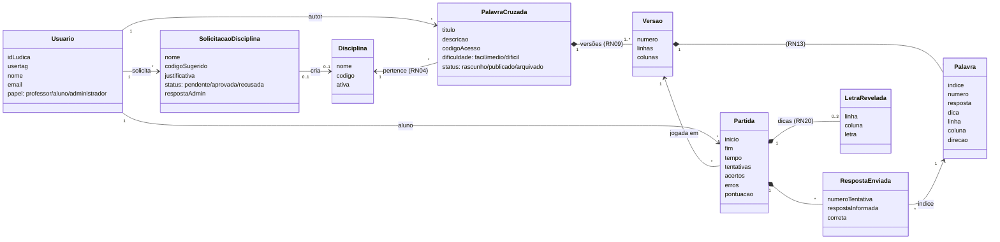
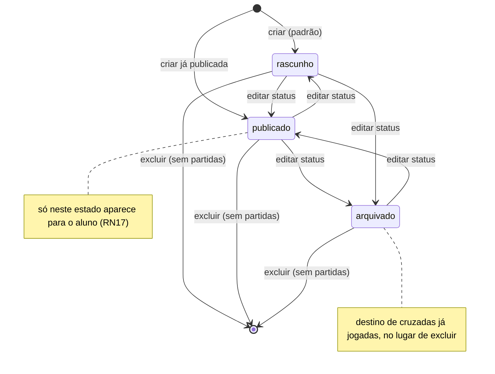
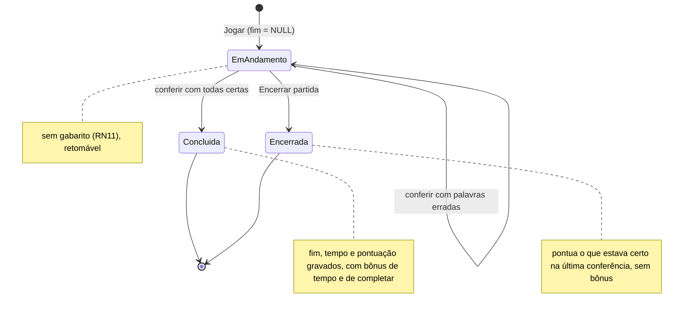
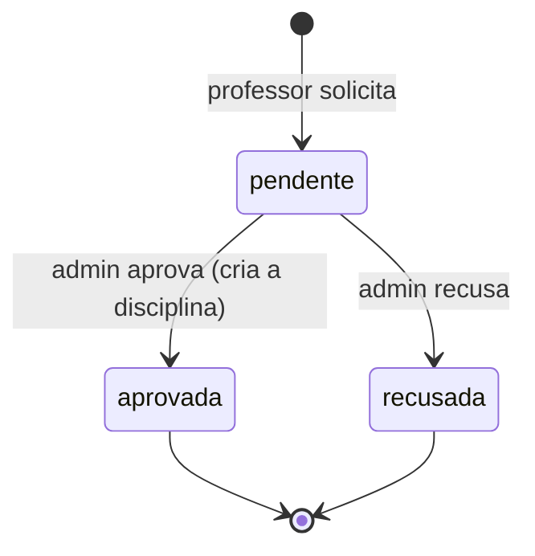
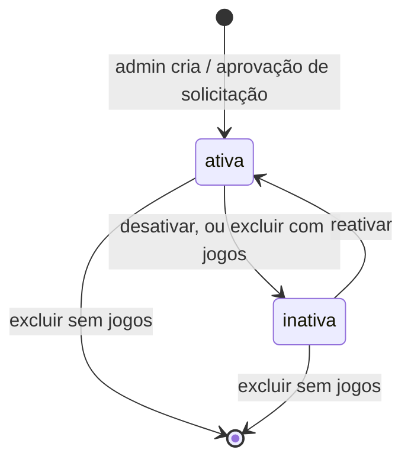
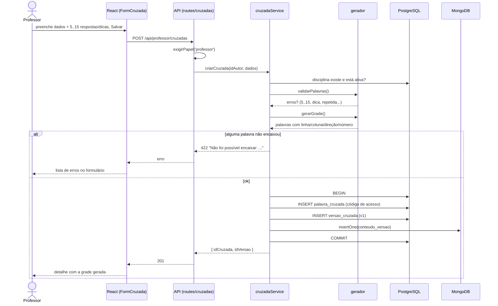
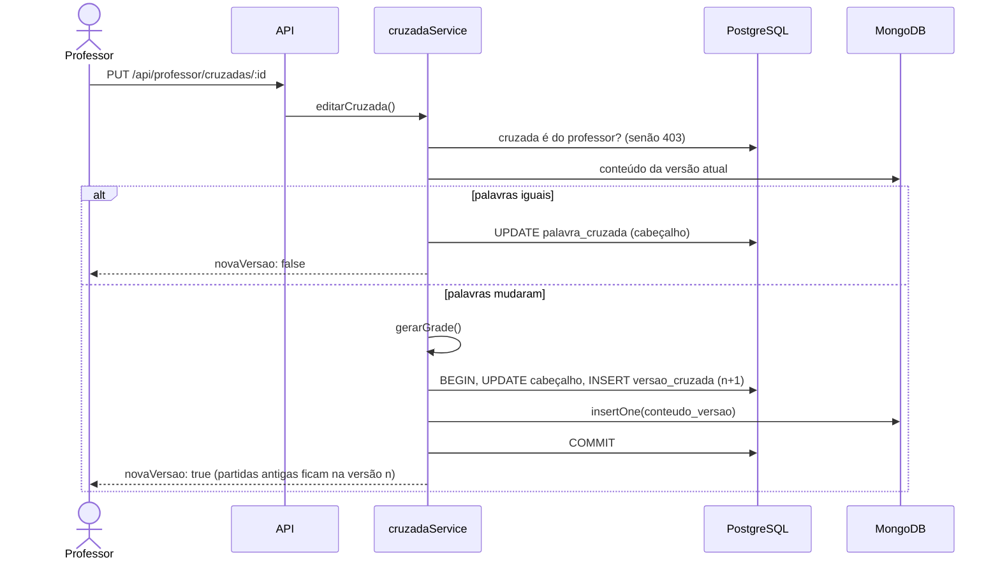
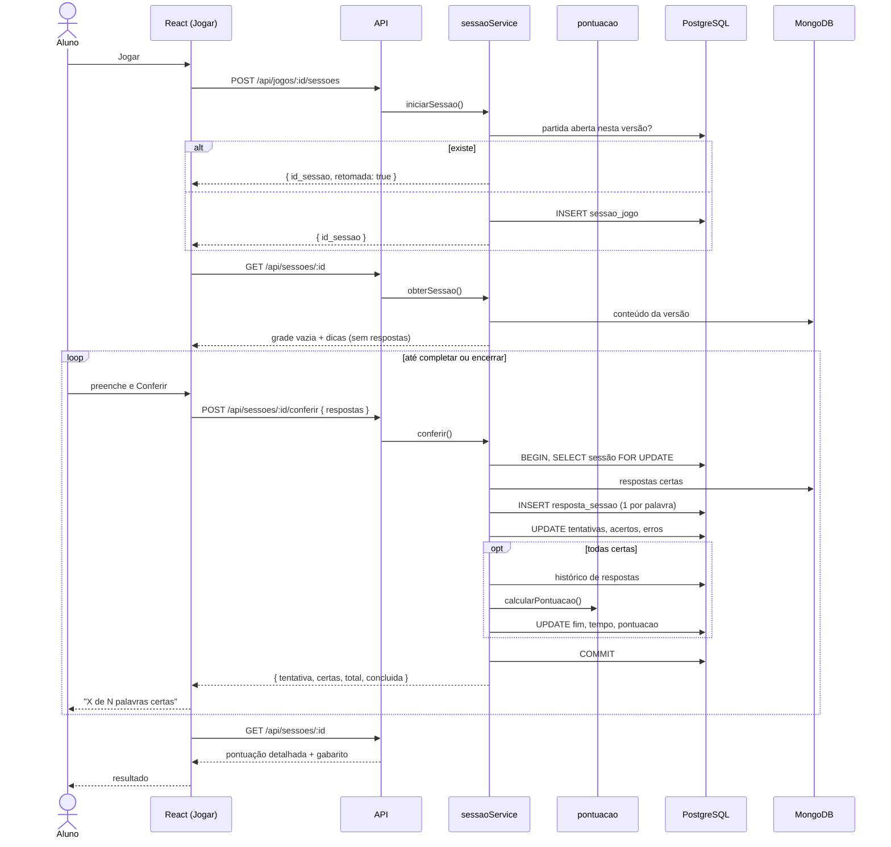
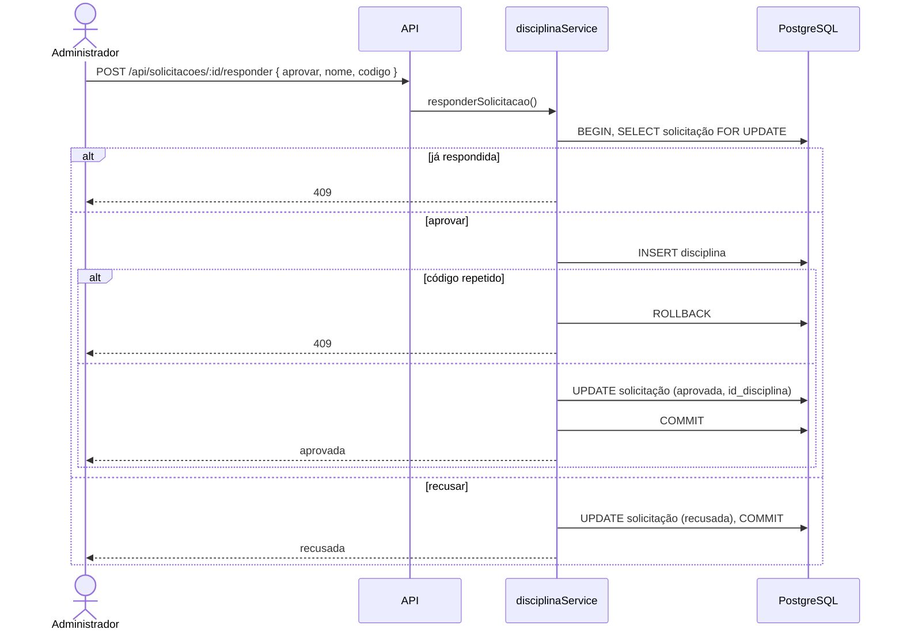
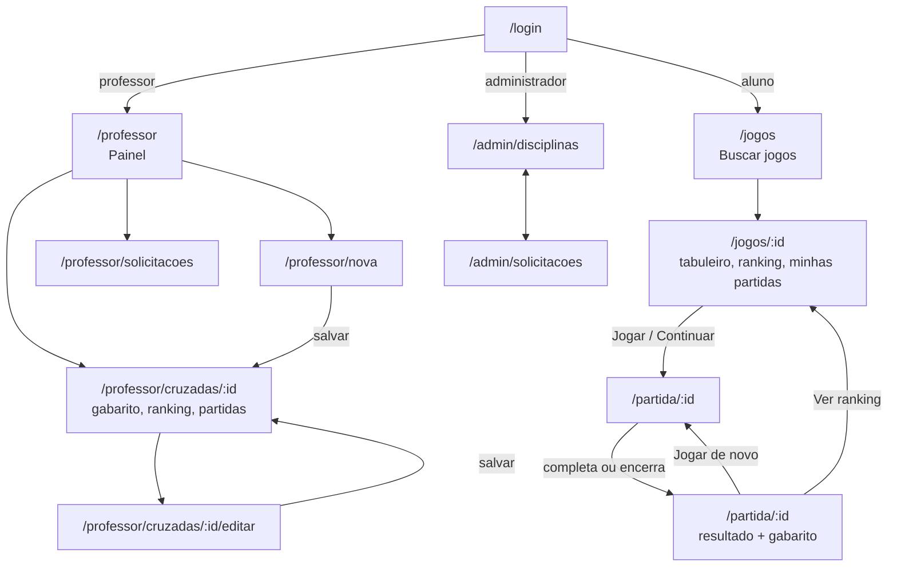

# Diagramas

Diagramas de domínio, estados e sequência. A estrutura dos bancos está em
[dicionario-de-dados.md](dicionario-de-dados.md) e
[modelo-de-dados.md](modelo-de-dados.md); a arquitetura (serviços e camadas),
em [arquitetura.md](arquitetura.md); o diagrama de casos de uso, em
[casos-de-uso.md](casos-de-uso.md).

## 1. Modelo de domínio (classes)

Conceitos do negócio e como se relacionam, independente de qual banco guarda cada um.

`Versao` + `Palavra` = `versao_cruzada` (Postgres) + `conteudo_versao` (Mongo).
`Partida` = `sessao_jogo`; `RespostaEnviada` = `resposta_sessao`; `LetraRevelada` = `dica_sessao`.

---

## 2. Diagramas de estado

### Cruzadinha (`palavra_cruzada.status`)

### Partida (`sessao_jogo`)

No banco, "Concluída" e "Encerrada" são o mesmo estado (`fim` preenchido). A
diferença é se `acertos = qtd_palavras`.

### Solicitação de disciplina

### Disciplina

---

## 3. Diagramas de sequência

### UC02 — Criar cruzadinha (com geração da grade)

### UC04 — Editar cruzadinha

### UC09 — Jogar cruzadinha

### UC12 — Responder solicitação de disciplina

---

## 4. Navegação entre telas

