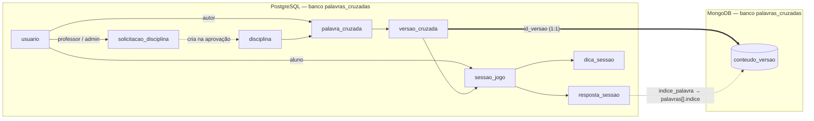
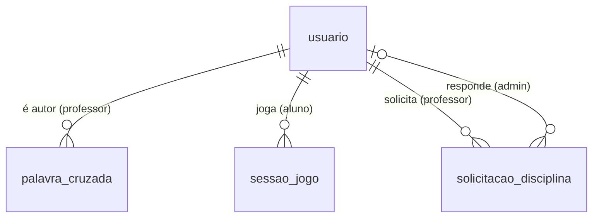
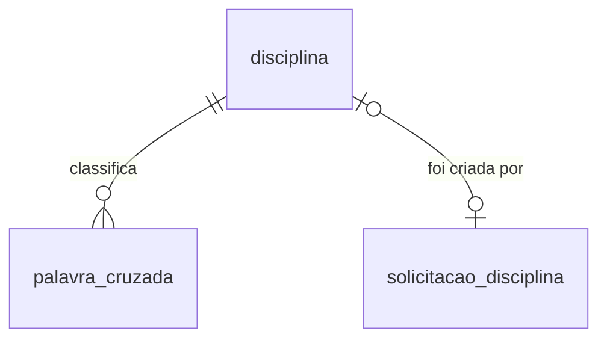
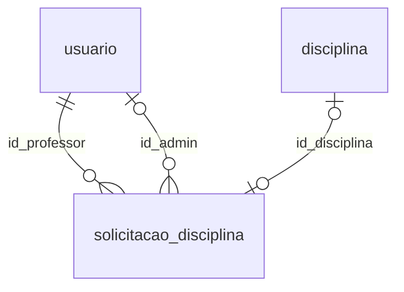
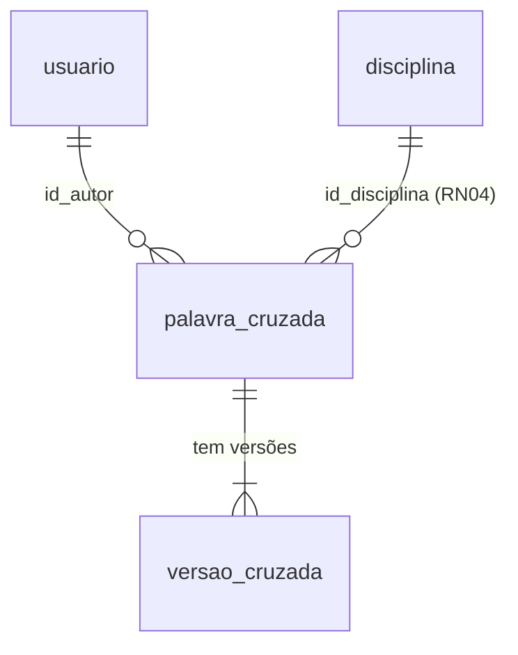
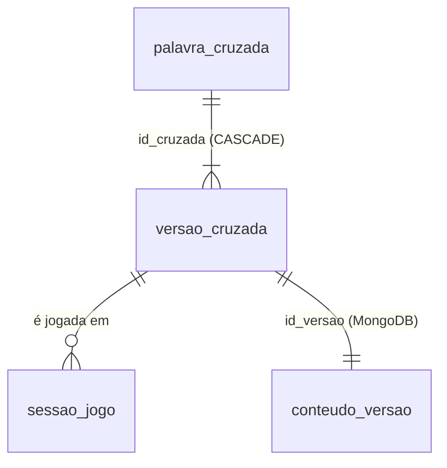
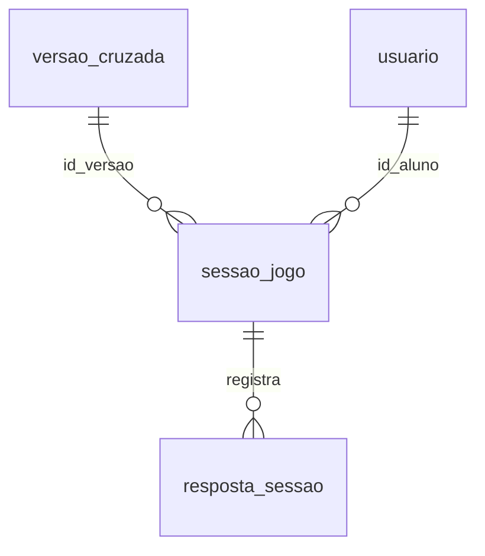
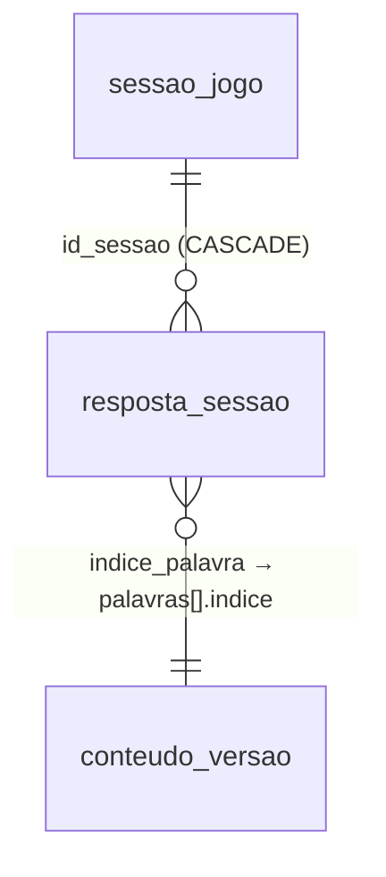
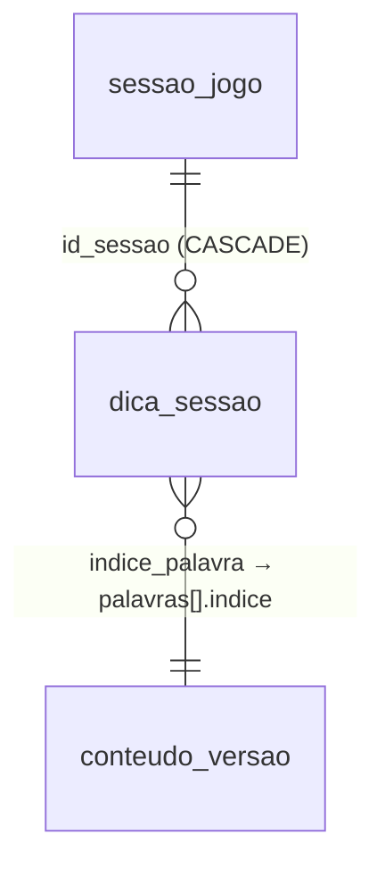
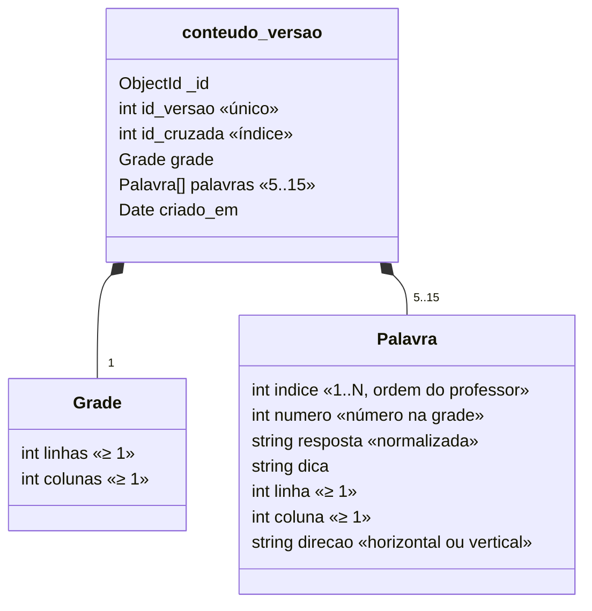

# Dicionário de dados

Descrição de cada tabela do PostgreSQL e da coleção do MongoDB, com as
relações, todas as colunas, as restrições e quem usa cada estrutura.

Fonte da verdade: [`schema.sql`](../backend/db/postgres/schema.sql) e
[`db/mongo.js`](../backend/src/db/mongo.js). A visão geral e a justificativa
da divisão entre os bancos estão em [modelo-de-dados.md](modelo-de-dados.md).

**Legenda:** PK = chave primária · FK = chave estrangeira · UK = único ·
Obrig. = `NOT NULL` · `CHECK` = regra validada pelo próprio banco.

## Mapa geral

| Estrutura | Banco | Grupo | Linhas típicas |
|---|---|---|---|
| `usuario` | Postgres | Cadastro | 1 por pessoa vinda do Lúdica |
| `disciplina` | Postgres | Cadastro | dezenas |
| `solicitacao_disciplina` | Postgres | Cadastro | poucas |
| `palavra_cruzada` | Postgres | Conteúdo | 1 por jogo |
| `versao_cruzada` | Postgres | Conteúdo | 1 por edição de palavras |
| `conteudo_versao` | **MongoDB** | Conteúdo | 1 documento por versão |
| `sessao_jogo` | Postgres | Jogo | 1 por partida |
| `resposta_sessao` | Postgres | Jogo | palavras × conferências, por partida |
| `dica_sessao` | Postgres | Jogo | até 3 por partida |

---

## `usuario`

Pessoas que usam o sistema. Vêm do **Lúdica**, que envia `id, usertag, email,
papel`. O sistema não guarda senha, porque quem autentica é o Lúdica.

| Coluna | Tipo | Obrig. | Padrão | Restrições | Descrição |
|---|---|---|---|---|---|
| `id_usuario` | SERIAL | ✔ | auto | PK | Identificador interno |
| `id_ludica` | INTEGER | ✔ | | UK | `id` enviado pelo Lúdica; chave do *upsert* |
| `usertag` | VARCHAR(50) | ✔ | | UK | Apelido no Lúdica (ex.: `prof.carlos`) |
| `nome` | VARCHAR(100) | | `usertag` (na API) | | Nome para exibição |
| `email` | VARCHAR(150) | ✔ | | UK | Gravado em minúsculas |
| `papel` | VARCHAR(20) | ✔ | | `CHECK IN ('professor','aluno','administrador')` | **RN01**: papel único |
| `data_cadastro` | TIMESTAMP | ✔ | `CURRENT_TIMESTAMP` | | Primeira sincronização |

**Usado por:** `usuarioService` (upsert, listar, obter), `middleware/auth.js` (sessão).

---

## `disciplina`

Matérias às quais as cruzadas pertencem. Mantidas pelo administrador.

| Coluna | Tipo | Obrig. | Padrão | Restrições | Descrição |
|---|---|---|---|---|---|
| `id_disciplina` | SERIAL | ✔ | auto | PK | |
| `nome` | VARCHAR(100) | ✔ | | | Ex.: "Banco de Dados" |
| `codigo` | VARCHAR(20) | ✔ | | UK; na API: `[A-Z0-9]{1,20}` | Ex.: `BD`. Também é o prefixo do código de acesso dos jogos |
| `ativa` | BOOLEAN | ✔ | `TRUE` | | **RN15**: desativada some dos formulários de jogo novo |
| `data_criacao` | TIMESTAMP | ✔ | `CURRENT_TIMESTAMP` | | |

**Regra de exclusão (RN15):** sem jogos, a disciplina é apagada; com jogos,
vira `ativa = FALSE`.
**Usado por:** `disciplinaService`.

---

## `solicitacao_disciplina`

Pedido de um professor para criar uma disciplina nova (**RN16**).

| Coluna | Tipo | Obrig. | Padrão | Restrições | Descrição |
|---|---|---|---|---|---|
| `id_solicitacao` | SERIAL | ✔ | auto | PK | |
| `id_professor` | INTEGER | ✔ | | FK → `usuario` | Quem pediu |
| `nome` | VARCHAR(100) | ✔ | | | Nome sugerido |
| `codigo_sugerido` | VARCHAR(20) | | | | Código sugerido (o admin pode trocar) |
| `justificativa` | TEXT | | | | |
| `status` | VARCHAR(20) | ✔ | `'pendente'` | `CHECK IN ('pendente','aprovada','recusada')` | Só sai de `pendente` uma vez |
| `id_admin` | INTEGER | | | FK → `usuario` | Quem respondeu |
| `id_disciplina` | INTEGER | | | FK → `disciplina` | Disciplina criada na aprovação |
| `resposta_admin` | TEXT | | | | Mensagem ao professor |
| `data_solicitacao` | TIMESTAMP | ✔ | `CURRENT_TIMESTAMP` | | |
| `data_resposta` | TIMESTAMP | | | | |

**Índice:** `idx_solicitacao_status (status)`.
**Usado por:** `disciplinaService` (`solicitarDisciplina`, `listarSolicitacoes`, `responderSolicitacao`).

---

## `palavra_cruzada`

Cabeçalho de um jogo: dados que **não** mudam a grade. O conteúdo (palavras)
fica nas versões.

| Coluna | Tipo | Obrig. | Padrão | Restrições | Descrição |
|---|---|---|---|---|---|
| `id_cruzada` | SERIAL | ✔ | auto | PK | |
| `id_autor` | INTEGER | ✔ | | FK → `usuario` | Professor autor (**RN02/RN03/RN08**) |
| `id_disciplina` | INTEGER | ✔ | | FK → `disciplina` | **RN04**: exatamente uma |
| `titulo` | VARCHAR(150) | ✔ | | | |
| `codigo_acesso` | VARCHAR(20) | ✔ | gerado | UK | `<código da disciplina>-<5 dígitos>`, ex.: `BD-27372`. O aluno busca por ele |
| `descricao` | TEXT | | | | |
| `dificuldade` | VARCHAR(20) | ✔ | `'facil'` | `CHECK IN ('facil','medio','dificil')` | **RN07**; multiplica a pontuação |
| `status` | VARCHAR(20) | ✔ | `'rascunho'` | `CHECK IN ('rascunho','publicado','arquivado')` | Só `publicado` aparece para o aluno (**RN17**) |
| `data_criacao` | TIMESTAMP | ✔ | `CURRENT_TIMESTAMP` | | |
| `data_atualizacao` | TIMESTAMP | ✔ | `CURRENT_TIMESTAMP` | | Atualizada em toda edição |

**Índices:** `idx_palavra_cruzada_autor`, `idx_palavra_cruzada_disciplina`, `idx_palavra_cruzada_status`.
**Exclusão:** apaga as versões em cascata e os documentos no Mongo. É bloqueada
se houver partidas (o certo é arquivar).
**Usado por:** `cruzadaService`, `jogoService`.

---

## `versao_cruzada`

Cada conjunto de palavras de uma cruzada. Uma versão **nunca é alterada**:
editar as palavras cria a próxima (**RN09**). O conteúdo da versão está no
MongoDB, com o mesmo `id_versao`.

| Coluna | Tipo | Obrig. | Padrão | Restrições | Descrição |
|---|---|---|---|---|---|
| `id_versao` | SERIAL | ✔ | auto | PK | **Chave de ligação com o MongoDB** |
| `id_cruzada` | INTEGER | ✔ | | FK → `palavra_cruzada` `ON DELETE CASCADE` | |
| `numero_versao` | INTEGER | ✔ | | UK junto com `id_cruzada` | 1, 2, 3… dentro da cruzada |
| `qtd_palavras` | INTEGER | ✔ | | `CHECK BETWEEN 5 AND 15` | **RN13** garantida pelo banco |
| `linhas` | INTEGER | ✔ | | `CHECK >= 1` | Tamanho da grade gerada (**RN14**) |
| `colunas` | INTEGER | ✔ | | `CHECK >= 1` | |
| `data_criacao` | TIMESTAMP | ✔ | `CURRENT_TIMESTAMP` | | |

**Restrição composta:** `UNIQUE (id_cruzada, numero_versao)`.
**Índice:** `idx_versao_cruzada_cruzada`.
**Versão atual** = maior `numero_versao` da cruzada.
**Usado por:** `cruzadaService` (`salvarComNovaVersao`), `jogoService`, `sessaoService`.

---

## `sessao_jogo`

Uma partida de um aluno numa versão específica (**RN10**: pode haver várias
por aluno). Guarda os números da partida (**RN12**).

| Coluna | Tipo | Obrig. | Padrão | Restrições | Descrição |
|---|---|---|---|---|---|
| `id_sessao` | SERIAL | ✔ | auto | PK | |
| `id_versao` | INTEGER | ✔ | | FK → `versao_cruzada` | Versão jogada (fica fixa mesmo se a cruzada for editada) |
| `id_aluno` | INTEGER | ✔ | | FK → `usuario` | |
| `inicio` | TIMESTAMP | ✔ | `CURRENT_TIMESTAMP` | | Hora do servidor |
| `fim` | TIMESTAMP | | | | `NULL` = partida em andamento |
| `tempo` | INTEGER | ✔ | `0` | | Segundos entre `inicio` e `fim`, calculado pelo Postgres |
| `tentativas` | INTEGER | ✔ | `0` | | Quantidade de conferências |
| `acertos` | INTEGER | ✔ | `0` | | Palavras certas na última conferência |
| `erros` | INTEGER | ✔ | `0` | | Soma das palavras erradas em **todas** as conferências |
| `pontuacao` | NUMERIC(7,2) | ✔ | `0.00` | | **RN19**; gravada ao encerrar |

**Índice:** `idx_sessao_aluno_versao (id_aluno, id_versao, inicio)`.
**Partida aberta:** `fim IS NULL`. Não entra em ranking nem em estatística.
**Usado por:** `sessaoService`, `jogoService` (ranking, partidas), `cruzadaService` (painel).

---

## `resposta_sessao`

O que o aluno enviou para **cada palavra em cada conferência**. É a base para
calcular em qual tentativa cada palavra foi acertada.

| Coluna | Tipo | Obrig. | Padrão | Restrições | Descrição |
|---|---|---|---|---|---|
| `id_resposta` | SERIAL | ✔ | auto | PK | |
| `id_sessao` | INTEGER | ✔ | | FK → `sessao_jogo` `ON DELETE CASCADE` | |
| `indice_palavra` | INTEGER | ✔ | | `CHECK BETWEEN 1 AND 15` | Posição da palavra no documento Mongo da versão da sessão |
| `resposta_informada` | VARCHAR(100) | ✔ | | | Já normalizada (maiúsculas, sem acento); vazia se a palavra ficou em branco |
| `correta` | BOOLEAN | ✔ | | | |
| `numero_tentativa` | INTEGER | ✔ | `1` | | Número da conferência (1, 2, 3…) |

**Índice:** `idx_resposta_sessao_sessao (id_sessao, indice_palavra)`.
**Por que não há FK para a palavra:** a palavra mora no MongoDB. Como a versão
é imutável, `(versão da sessão, indice_palavra)` sempre identifica a mesma palavra.
**Usado por:** `sessaoService`.

---

## `dica_sessao`

Cada letra revelada pela dica **revelar letra** durante uma partida (**RN20**).

| Coluna | Tipo | Obrig. | Padrão | Restrições | Descrição |
|---|---|---|---|---|---|
| `id_dica` | SERIAL | ✔ | auto | PK | |
| `id_sessao` | INTEGER | ✔ | | FK → `sessao_jogo` `ON DELETE CASCADE` | |
| `indice_palavra` | INTEGER | ✔ | | `CHECK BETWEEN 1 AND 15` | Palavra em que o aluno pediu a dica |
| `linha` | INTEGER | ✔ | | `CHECK >= 1` | Casa revelada |
| `coluna` | INTEGER | ✔ | | `CHECK >= 1` | |
| `letra` | CHAR(1) | ✔ | | | Letra revelada |
| `data_dica` | TIMESTAMP | ✔ | `CURRENT_TIMESTAMP` | | |

**Restrição composta:** `UNIQUE (id_sessao, linha, coluna)`: a mesma casa não é revelada duas vezes.
**Limite:** no máximo 3 linhas por sessão (`DICAS.maxPorPartida`), garantido pela API.
**Desconto:** a casa `(linha, coluna)` desconta de **cada palavra que passa por ela** (`reveladasPorPalavra` em `services/dica.js`).
**Usado por:** `sessaoService` (`revelarLetra`, estado e resultado da partida), `jogoService` (contagem de dicas no ranking e nas partidas).

---

## MongoDB — coleção `conteudo_versao`

Conteúdo de cada versão: as palavras com resposta, dica e posição gerada, e o
tamanho da grade. Um documento por linha de `versao_cruzada`.

| Campo | Tipo BSON | Obrig. | Regra (`$jsonSchema`) | Descrição |
|---|---|---|---|---|
| `_id` | ObjectId | ✔ | | Gerado pelo Mongo |
| `id_versao` | int | ✔ | índice **único** | = `versao_cruzada.id_versao` |
| `id_cruzada` | int | ✔ | índice | = `palavra_cruzada.id_cruzada`; usado para apagar tudo ao excluir |
| `grade.linhas` | int | ✔ | `≥ 1` | |
| `grade.colunas` | int | ✔ | `≥ 1` | |
| `palavras` | array | ✔ | `minItems 5`, `maxItems 15` | **RN13** também garantida aqui |
| `palavras[].indice` | int | ✔ | `≥ 1` | Ordem em que o professor cadastrou; referenciado por `resposta_sessao.indice_palavra` |
| `palavras[].numero` | int | ✔ | `≥ 1` | Número exibido na grade e nas dicas |
| `palavras[].resposta` | string | ✔ | | Maiúsculas, sem acento e sem espaços. **Nunca enviada ao aluno com a partida aberta (RN11)** |
| `palavras[].dica` | string | ✔ | | |
| `palavras[].linha` / `coluna` | int | ✔ | `≥ 1` | Início da palavra, gerado pelo sistema (**RN14**) |
| `palavras[].direcao` | string | ✔ | `enum: horizontal, vertical` | |
| `criado_em` | date | ✔ | | |

**Ciclo de vida:** inserido junto com a versão (`salvarComNovaVersao`), nunca
atualizado, e apagado com `deleteMany({ id_cruzada })` quando a cruzada é excluída.
**Usado por:** `cruzadaService` (gravar, ler com gabarito), `jogoService`
(tabuleiro sem respostas), `sessaoService` (conferir e gabarito final).

---

## Domínios (valores permitidos)

| Domínio | Valores | Onde |
|---|---|---|
| Papel | `professor`, `aluno`, `administrador` | `usuario.papel` |
| Dificuldade | `facil`, `medio`, `dificil` | `palavra_cruzada.dificuldade` |
| Status da cruzada | `rascunho`, `publicado`, `arquivado` | `palavra_cruzada.status` |
| Status da solicitação | `pendente`, `aprovada`, `recusada` | `solicitacao_disciplina.status` |
| Direção | `horizontal`, `vertical` | `conteudo_versao.palavras[].direcao` |

## Regras que o banco garante sozinho

| Regra | Como |
|---|---|
| RN01 — papel único e válido | `CHECK` em `usuario.papel` |
| RN04 — uma disciplina por cruzada | FK simples `palavra_cruzada.id_disciplina NOT NULL` |
| RN07 — dificuldade | `CHECK` em `palavra_cruzada.dificuldade` |
| RN13 — 5 a 15 palavras | `CHECK` em `versao_cruzada.qtd_palavras` **e** `$jsonSchema` no Mongo |
| Usuário único no Lúdica | `UNIQUE` em `id_ludica`, `usertag`, `email` |
| Número de versão não se repete na mesma cruzada | `UNIQUE (id_cruzada, numero_versao)` |
| Código de acesso e de disciplina únicos | `UNIQUE` |
| Mesma casa não é revelada duas vezes na partida | `UNIQUE (id_sessao, linha, coluna)` em `dica_sessao` |
| Partidas não são apagadas por engano | `sessao_jogo.id_versao` **sem** cascade: o banco impede apagar uma versão já jogada |

As demais regras (permissões, geração da grade, pontuação…) ficam na API. Ver
[rastreabilidade.md](rastreabilidade.md).
