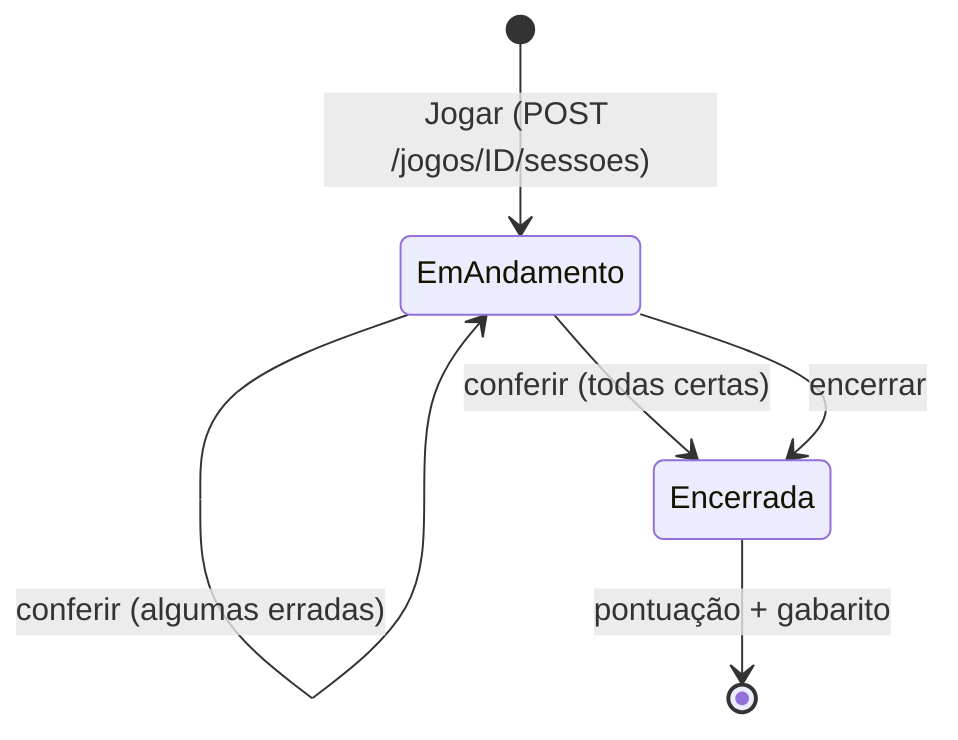

# Jogo do aluno e pontuação

Código: [`sessaoService.js`](../backend/src/services/sessaoService.js),
[`pontuacao.js`](../backend/src/services/pontuacao.js),
[`regras.js`](../backend/src/regras.js) (`PONTUACAO`),
tela [`Jogar.jsx`](../frontend/src/paginas/aluno/Jogar.jsx) ·
testes: [`pontuacao.test.js`](../backend/test/pontuacao.test.js)

## Como o aluno joga (RN18)

1. Em **Buscar jogos**, ele abre um jogo publicado e clica em **Jogar**.
   - Se já houver uma partida aberta naquela versão, ela é **retomada**, com a
     grade preenchida com a última conferência.
   - Pode jogar quantas vezes quiser (RN10). Cada vez é uma `sessao_jogo` nova.
2. Preenche a grade:
   - clicar numa casa ou numa dica escolhe a palavra (destacada);
   - clicar de novo na mesma casa troca entre horizontal e vertical;
   - ao digitar, o cursor anda sozinho; Backspace apaga e volta; as setas movem;
   - acentos são ignorados (`Ç` → `C`).
3. **Conferir respostas** envia a grade inteira. O sistema responde **só quantas
   palavras estão certas** ("Tentativa 2: 5 de 8 palavras certas"), sem dizer quais.
4. Ele ajusta e confere de novo, quantas vezes quiser.
5. A partida termina:
   - **sozinha**, quando todas estão certas; ou
   - em **Encerrar partida**: vale o que estava certo na última conferência.
     Encerrar sem conferir nenhuma vez dá zero.
6. Tela de resultado: pontuação detalhada, **gabarito** (só agora — RN11),
   comparação "sua resposta × resposta certa" e o botão **Jogar de novo**.



## Dica: revelar letra (RN20)

Código: [`dica.js`](../backend/src/services/dica.js) (lógica pura),
`revelarLetra` em [`sessaoService.js`](../backend/src/services/sessaoService.js),
configuração `DICAS` em [`regras.js`](../backend/src/regras.js) ·
testes: [`dica.test.js`](../backend/test/dica.test.js)

1. Com uma palavra selecionada, o aluno clica em **💡 Revelar letra (N)** e confirma o custo.
2. O navegador envia `{ indice, atual }`: o índice da palavra e o que está na tela para ela (`' '` = casa vazia).
3. O servidor escolhe a casa:
   - a primeira casa **vazia** da palavra que ainda não foi revelada;
   - se a palavra estiver toda preenchida, a primeira casa ainda não revelada.

   A escolha **nunca depende de a letra digitada estar certa**. Se dependesse, pedir dica numa palavra preenchida mostraria de graça se ela está correta, o que quebraria a regra de só informar a contagem (RN18).
4. A letra volta, entra na grade **travada** (fundo amarelo; digitar ou apagar não a altera) e fica gravada em `dica_sessao`. Ao retomar a partida, ela continua lá.

| Regra | Valor (`DICAS` em `regras.js`) |
|---|---|
| Dicas por partida | 3 |
| Custo | 20% dos pontos de **cada palavra que passa pela casa revelada** |

O custo vale para todas as palavras que passam pela casa: uma letra num
cruzamento desconta das duas palavras, porque ajuda as duas. Com 5 letras
reveladas, uma palavra deixa de valer pontos.

Erros: 409 ao pedir a 4ª dica, numa palavra com todas as letras já reveladas
ou numa partida encerrada; 422 se a palavra não existir; 403 em partida de
outro aluno.

## O que é registrado (RN12)

| Onde | O quê |
|---|---|
| `sessao_jogo.inicio` / `fim` | horário do servidor |
| `sessao_jogo.tempo` | segundos entre início e fim (calculado pelo Postgres) |
| `sessao_jogo.tentativas` | número de conferências |
| `sessao_jogo.acertos` | palavras certas no fim |
| `sessao_jogo.erros` | **soma** das palavras erradas em todas as conferências |
| `sessao_jogo.pontuacao` | pontos finais |
| `resposta_sessao` | uma linha por palavra por conferência: `indice_palavra`, `resposta_informada`, `correta`, `numero_tentativa` |
| `dica_sessao` | uma linha por letra revelada: `indice_palavra`, `linha`, `coluna`, `letra` (RN20) |

Partidas abertas (`fim IS NULL`) não entram no ranking nem nas estatísticas do professor.

## Pontuação (RN19)

Todos os números ficam em `PONTUACAO`, em `backend/src/regras.js`. Mudar um
valor ali muda o cálculo, sem mexer na lógica.

### 1. Pontos por palavra, pela tentativa do acerto

| Acertou na… | Vale |
|---|---|
| 1ª conferência | 100 |
| 2ª | 70 |
| 3ª | 50 |
| 4ª ou depois | 30 |
| terminou errada | 0 |

**Regra importante:** vale a tentativa a partir da qual a palavra **ficou certa
até o fim**. Se acertou na 1ª, trocou na 2ª e voltou a acertar na 3ª, conta
como 3ª. Isso impede que o aluno "chute" trocando palavras certas sem perder pontos.

### 2. Multiplicador de dificuldade (RN07)

Fácil ×1 · Médio ×1,2 · Difícil ×1,5, aplicado aos pontos das palavras.

### 3. Bônus de tempo (só para quem completa)

Até **+20%** dos pontos das palavras, caindo em linha reta até zero quando o
tempo chega a **60 s por palavra** (8 palavras = 8 minutos).

### 4. Desconto das dicas (RN20)

Cada letra revelada tira **20%** dos pontos de cada palavra que passa por ela (seção anterior).

### 5. Bônus por completar

**+10%** dos pontos das palavras se todas terminaram certas.

### Fórmula

```
pontos_palavras = Σ (100 × fator_da_tentativa × (1 − 0,2 × letras_reveladas_na_palavra)) × multiplicador_dificuldade
bonus_tempo     = completa ? pontos_palavras × 0,20 × max(0, 1 − tempo / (palavras × 60)) : 0
bonus_completa  = completa ? pontos_palavras × 0,10 : 0
total           = arredonda(pontos_palavras + bonus_tempo + bonus_completa)
```

### Exemplos

| Situação | Cálculo | Total |
|---|---|---|
| 5 palavras, fácil, todas de primeira, instantâneo | 500 + 100 (tempo) + 50 (completa) | **650** |
| 8 palavras, fácil, 3 na 1ª e 5 na 2ª, 3 s | 300 + 350 = 650; +129; +65 | **844** |
| 7 palavras, médio, 2 na 1ª, 2 na 2ª, 3 na 3ª | (200 + 140 + 150) × 1,2 = 588; + bônus | depende do tempo |
| 5 palavras, difícil, 2 certas e encerrou | 200 × 1,5 = 300, sem bônus | **300** |

A tela de resultado mostra essa conta linha a linha.

## Ranking

- Por cruzada, com a **melhor partida de cada aluno**.
- Ordem: pontuação (maior primeiro) e, no empate, tempo (menor primeiro).
- Top 10, visível para o aluno (página do jogo, com a linha dele destacada) e
  para o professor autor (detalhe da cruzada).
- Considera todas as versões da cruzada. A coluna de versão aparece nas partidas do professor.

## Visão do professor

No detalhe de cada cruzada:
- **Ranking**;
- **Partidas dos alunos**: aluno, data, versão, certas, conferências, erros, tempo, pontos;
- **Histórico de versões**, com quantas partidas cada versão teve.

O painel mostra jogos criados, alunos que jogaram e média de acertos
(`acertos / (acertos + erros)` somando as partidas encerradas).

## Ideias ainda não implementadas ("outros fatores")

- Outros tipos de dica: verificar se uma palavra está certa, revelar a palavra inteira, dica extra do professor.
- Peso maior para palavras mais longas.
- Bônus de sequência (várias palavras de primeira).
- Pontuar no ranking só a **primeira** partida, ou reduzir os pontos das
  repetições, para não premiar quem decora o gabarito.
- Limite de conferências por partida.
