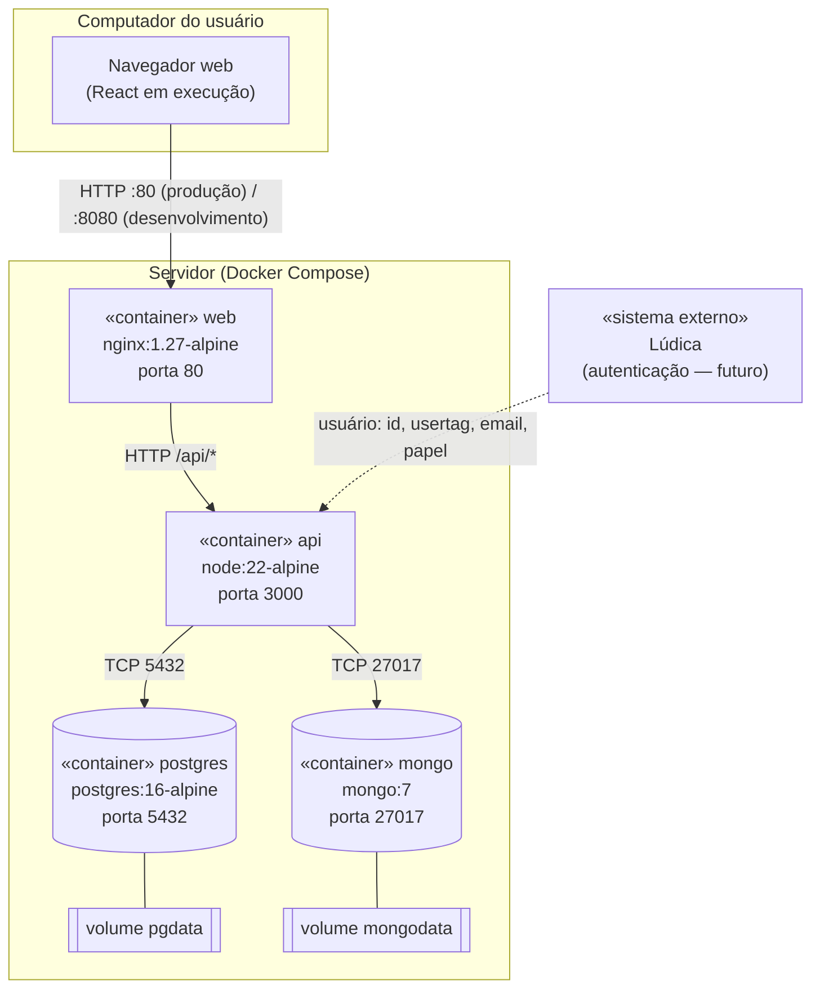
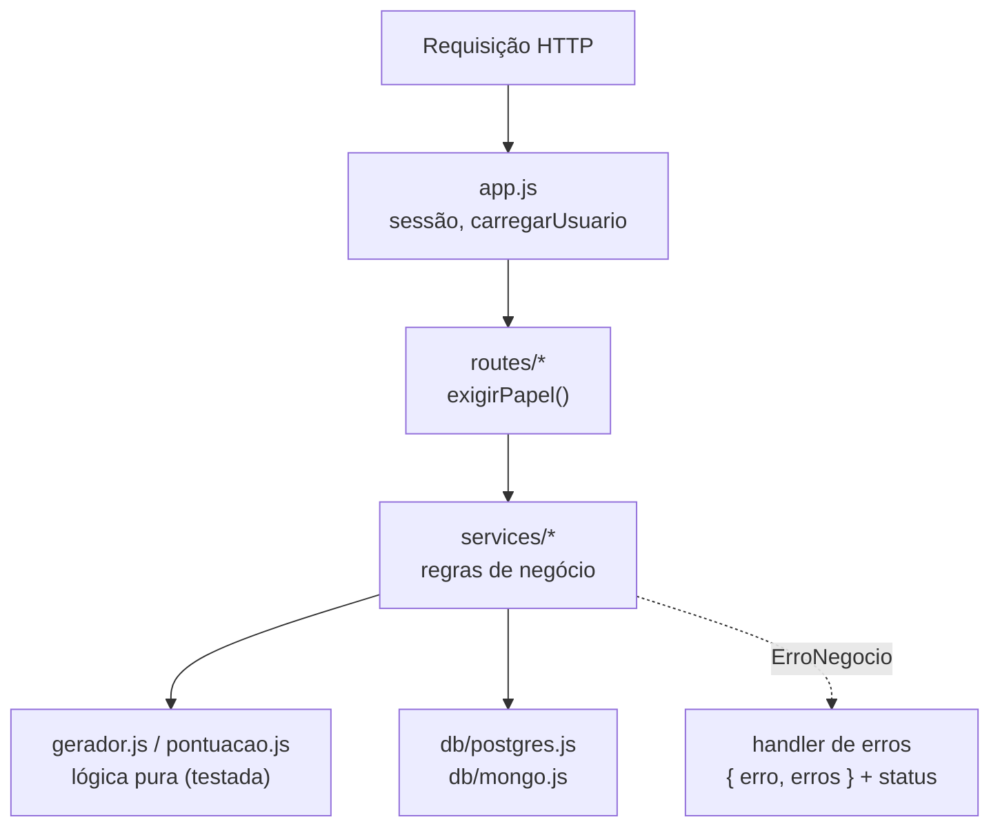
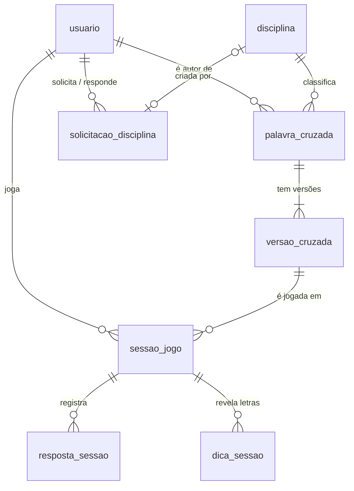
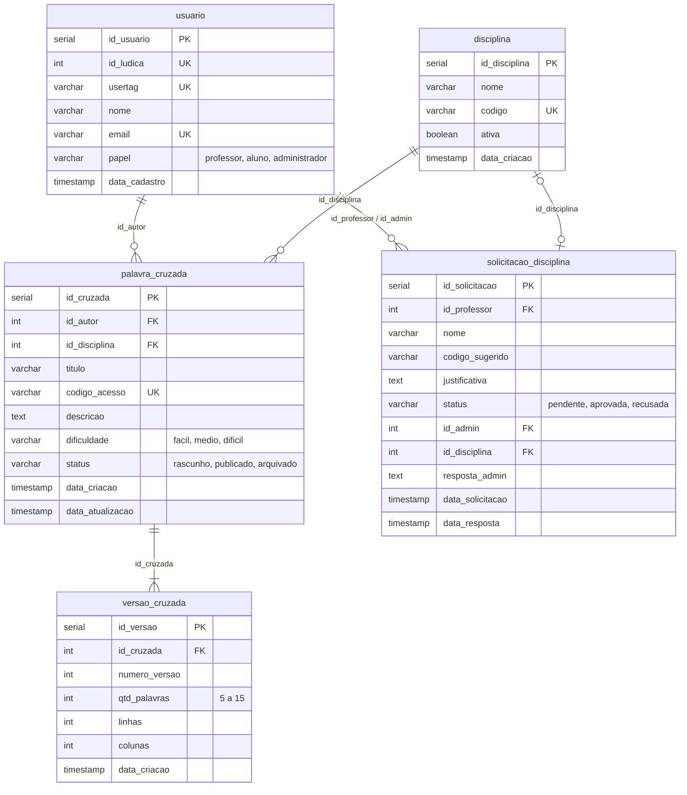
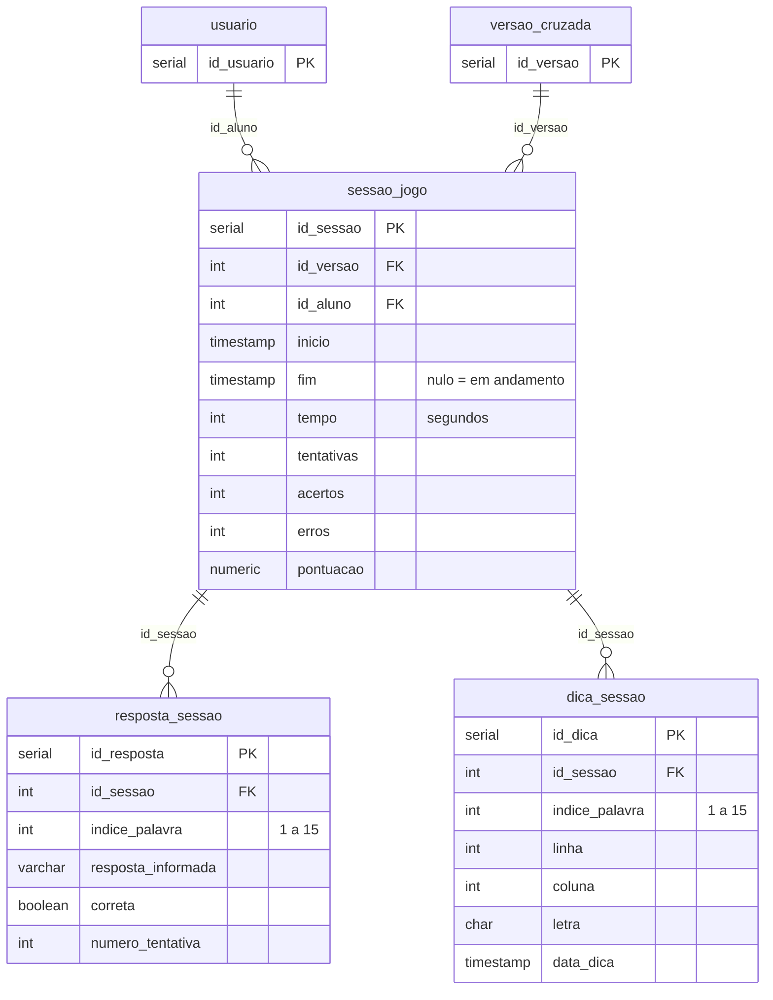
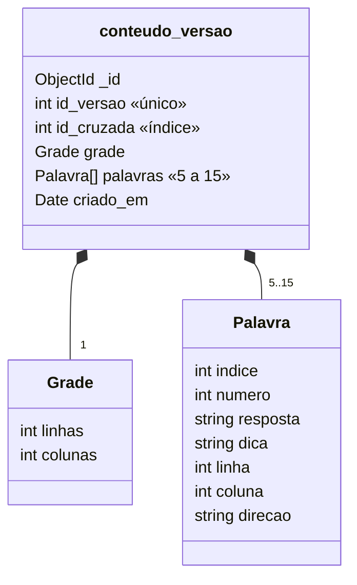
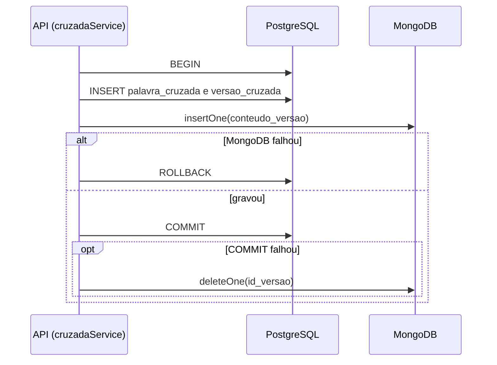

# Manual do Desenvolvedor — Cruzadinha Digital

**Projeto:** Cruzadinha Digital — Jogo de Palavras Cruzadas para Ciência da Computação (CEFET-RJ)
**Disciplina:** Projeto e Construção de Sistemas
**Repositório:** https://github.com/marceloareas/PalavrasCruzadas (branch `dev`)
**Versão do documento:** 1.1 — outubro de 2026

## 1. Introdução

Este manual reúne o necessário para que um novo desenvolvedor consiga:

- entender a arquitetura do sistema e a organização do código;
- montar o ambiente de desenvolvimento e rodar a aplicação e os testes;
- conhecer o modelo de dados (PostgreSQL e MongoDB);
- publicar (fazer o *deploy*) da aplicação em um servidor.

A Cruzadinha Digital é uma aplicação web em que **professores** criam
palavras cruzadas cadastrando apenas respostas e dicas (o sistema monta a
grade), **alunos** pesquisam e resolvem os jogos com pontuação e ranking, e um
**administrador** mantém as disciplinas. O sistema vai rodar dentro da
**Lúdica**, uma central de jogos educacionais, que fará a autenticação.

Documentação complementar, mais detalhada, está na pasta `docs/` do
repositório (lista completa na seção 11).

## 2. Arquitetura

### 2.1 Visão geral

A aplicação é formada por **quatro serviços**, cada um em um container Docker:

| Serviço | Tecnologia | Função |
|---|---|---|
| `web` | nginx 1.27 servindo o build do React | Entrega a interface e repassa as chamadas `/api/*` para a API |
| `api` | Node.js 22 + Express 5 | API REST em JSON com todas as regras de negócio |
| `postgres` | PostgreSQL 16 | Dados relacionais: usuários, disciplinas, cruzadas, versões, partidas |
| `mongo` | MongoDB 7 | Conteúdo de cada versão de cruzada: palavras, dicas e grade gerada |

O navegador conversa **apenas com o nginx**: a página e a API ficam na mesma
origem, então o cookie de sessão funciona sem configurar CORS.

### 2.2 Diagrama de implantação



- Em **desenvolvimento**, todas as portas são publicadas no host (8080, 3000,
  5432, 27017) para facilitar a depuração.
- Em **produção**, só o nginx é publicado. API e bancos ficam acessíveis
  apenas pela rede interna do Compose (seção 8).
- Os dados ficam em **volumes** Docker (`pgdata`, `mongodata`) e sobrevivem à
  recriação dos containers.

### 2.3 Tecnologias e versões

| Camada | Tecnologia | Versão |
|---|---|---|
| Interface | React, React Router, Vite | 18.3, 6.28, 5.4 |
| API | Node.js, Express, express-session | 22 (imagem) / 22+ local, 5.1, 1.18 |
| Acesso a dados | `pg` (PostgreSQL), `mongodb` (driver oficial) | 8.13, 6.10 |
| Bancos | PostgreSQL, MongoDB | 16, 7 |
| Servidor web | nginx | 1.27 |
| Testes | `node:test` (nativo do Node) | — |
| Infraestrutura | Docker, Docker Compose | Compose v2.24 ou mais novo |

### 2.4 Camadas da API



| Camada | Arquivos | Responsabilidade |
|---|---|---|
| Entrada | `server.js`, `app.js` | Conectar no Mongo, criar dados de exemplo, montar o Express, sessão, `/api/health`, `/api/regras`, tratamento de erros |
| Rotas | `routes/auth.js`, `routes/cruzadas.js`, `routes/disciplinas.js` | Ler parâmetros, checar o papel do usuário, chamar o service e devolver JSON |
| Middleware | `middleware/auth.js` | Carregar o usuário da sessão; responder 401/403 por papel |
| Services | `services/*.js` | Validação, regras de negócio, transações, gravação nos dois bancos |
| Lógica pura | `services/gerador.js`, `services/pontuacao.js` | Gerar a grade e calcular pontos, sem banco (cobertas por testes unitários) |
| Dados | `db/postgres.js`, `db/mongo.js` | Pool e transações; conexão e coleção com validação `$jsonSchema` |
| Configuração | `regras.js` | Limites (5 a 15 palavras etc.), papéis, dificuldades e tabela de pontuação |

Os erros de negócio são lançados como `ErroNegocio` e viram respostas
`{ "erro": "...", "erros": ["..."] }` com o status adequado (422 validação,
403 permissão, 404 não encontrado, 409 conflito).

## 3. Ambiente de desenvolvimento

### 3.1 Pré-requisitos

| Ferramenta | Para quê | Obrigatório? |
|---|---|---|
| **Git** | Obter o código | Sim |
| **Docker Desktop** (Windows/macOS) ou Docker Engine + Compose (Linux) | Rodar os 4 serviços | Sim |
| **Node.js 22+** e npm | Rodar os testes e desenvolver com recarga automática fora do Docker | Recomendado |
| Editor (ex.: VS Code) | — | — |

O Docker Desktop precisa estar **aberto e em execução** antes dos comandos `docker`.

### 3.2 Obter o código

```bash
git clone https://github.com/marceloareas/PalavrasCruzadas.git
cd PalavrasCruzadas
git checkout dev
```

### 3.3 Subir a aplicação com Docker

Na raiz do repositório:

```bash
docker compose up --build
```

Na primeira vez o Docker baixa as imagens e compila o front e a API (alguns
minutos). Quando aparecer `API Cruzadinha Digital em http://localhost:3000/api`
no log, a aplicação está pronta:

| O quê | Endereço |
|---|---|
| Aplicação | http://localhost:8080 |
| API | http://localhost:3000/api (ex.: `/api/health` → `{"status":"ok"}`) |
| PostgreSQL | `localhost:5432` — usuário `postgres`, senha `postgres`, banco `palavras_cruzadas` |
| MongoDB | `localhost:27017` — banco `palavras_cruzadas` (sem senha em desenvolvimento) |

Comandos úteis:

| Comando | Efeito |
|---|---|
| `docker compose up -d --build` | Sobe em segundo plano |
| `docker compose logs -f api` | Acompanha o log da API |
| `docker compose down` | Para os containers (mantém os dados) |
| `docker compose down -v` | Para e **apaga os dados** (volumes) — recomeça do zero |

**Primeira subida (dados iniciais):**

1. O PostgreSQL executa `backend/db/postgres/schema.sql` (tabelas) e
   `seed.sql` (usuários, disciplinas e uma solicitação). Esses scripts **só
   rodam com o volume vazio**: depois de mudar o `schema.sql`, rode
   `docker compose down -v`.
2. A API cria a coleção do MongoDB e, se não houver nenhuma cruzada, cria 4
   cruzadas de exemplo e 3 partidas (`src/seedExemplos.js`), usando o mesmo
   gerador de grade do sistema. Para desligar: `SEED_EXEMPLOS=false`.

### 3.4 Usuários de teste

O login ainda é **simulado**: na tela de login escolhe-se um usuário em
"Entrar como" (ver seção 7.3).

| id (Lúdica) | usertag | Papel |
|---|---|---|
| 1002 | `prof.carlos` | Professor (cruzadas de ES e GoF) |
| 1001 | `prof.ana` | Professor (cruzadas de BD e SO, 1 solicitação pendente) |
| 2001 | `aluno.bruno` | Aluno |
| 2002 | `aluno.duda` | Aluno |
| 2003 | `aluno.rafa` | Aluno |
| 9001 | `admin.dcc` | Administrador |

### 3.5 Desenvolver com recarga automática

Para editar o código e ver o resultado sem reconstruir imagens, rode só os
bancos no Docker e a API e o front com Node:

```bash
# terminal 1 — bancos
docker compose up postgres mongo

# terminal 2 — API (http://localhost:3000/api)
cd backend
cp .env.example .env
npm install
npm run dev

# terminal 3 — front (http://localhost:5173)
cd frontend
npm install
npm run dev
```

O Vite repassa `/api` para `localhost:3000` (configurado em
`frontend/vite.config.js`). Para usar outra API: `API_URL=http://host:3000 npm run dev`.

### 3.6 Variáveis de ambiente da API

| Variável | Padrão | Descrição |
|---|---|---|
| `PGHOST`, `PGPORT` | `localhost`, `5432` | Servidor PostgreSQL |
| `PGUSER`, `PGPASSWORD` | `postgres`, `postgres` | Credenciais do PostgreSQL |
| `PGDATABASE` | `palavras_cruzadas` | Banco |
| `MONGO_URL` | `mongodb://localhost:27017` | URL de conexão do MongoDB |
| `MONGO_DB` | `palavras_cruzadas` | Banco no MongoDB |
| `PORT` | `3000` | Porta da API |
| `SESSION_SECRET` | valor de desenvolvimento | Segredo que assina o cookie de sessão — **troque em produção** |
| `NODE_ENV` | — | `production` esconde detalhes de erros internos |
| `SEED_EXEMPLOS` | `true` | Cria as cruzadas de exemplo na primeira subida |

No Docker essas variáveis estão no `docker-compose.yml`; fora dele, no
`backend/.env` (modelo em `backend/.env.example`).

### 3.7 Testes automatizados

```bash
cd backend
npm install
npm test
```

São 20 testes, que não precisam de banco:

| Arquivo | O que verifica |
|---|---|
| `test/gerador.test.js` | Limite de 5 a 15 palavras, dica obrigatória, resposta repetida; grade sem conflitos e sem "palavras acidentais"; mesma entrada gera a mesma grade; 15 palavras encaixam; palavra sem letra em comum é apontada; a grade do aluno não revela letras |
| `test/pontuacao.test.js` | Tentativa do acerto (inclusive "acertou, errou e acertou de novo"), pontos por tentativa, multiplicador de dificuldade, bônus de tempo e de grade completa |
| `test/dica.test.js` | Dica "revelar letra": escolhe a primeira casa vazia, não depende de a letra digitada estar certa, pula casas já reveladas, letra num cruzamento conta para as duas palavras, desconto de 20% por letra |

## 4. Estrutura do código

```text
PalavrasCruzadas/
├── docker-compose.yml          4 serviços (desenvolvimento)
├── docker-compose.prod.yml     ajustes de produção (seção 8)
├── .env.prod.example           modelo das variáveis de produção
├── README.md
├── docs/                       documentação (inclui estes manuais)
├── backend/                    API
│   ├── Dockerfile
│   ├── package.json
│   ├── .env.example
│   ├── db/
│   │   ├── postgres/schema.sql   tabelas, restrições e índices
│   │   ├── postgres/seed.sql     dados iniciais
│   │   └── mongo/modelo.md       modelo da coleção conteudo_versao
│   ├── src/
│   │   ├── server.js             ponto de entrada
│   │   ├── app.js                Express, sessão, rotas /api, erros
│   │   ├── regras.js             limites e tabela de pontuação
│   │   ├── seedExemplos.js       cruzadas e partidas de exemplo
│   │   ├── db/                   postgres.js, mongo.js
│   │   ├── middleware/auth.js    sessão e papéis
│   │   ├── routes/               auth.js, cruzadas.js, disciplinas.js
│   │   └── services/             cruzada, jogo, sessão (partida), disciplina,
│   │                             usuário, gerador, pontuação, erros
│   └── test/                   gerador.test.js, pontuacao.test.js
└── frontend/                   interface
    ├── Dockerfile, nginx.conf, vite.config.js, index.html
    └── src/
        ├── main.jsx              rotas por papel
        ├── Sessao.jsx            usuário logado e proteção de rotas
        ├── api.js                cliente HTTP
        ├── estilo.css            tema visual
        ├── componentes/          Layout, Grade, Ranking, mensagens
        └── paginas/              Login, professor/, aluno/, admin/
```

**Onde mexer para…**

| Tarefa | Arquivo(s) |
|---|---|
| Mudar o limite de palavras | `backend/src/regras.js` e o `CHECK` de `versao_cruzada` em `schema.sql` |
| Mudar a pontuação | `backend/src/regras.js` → `PONTUACAO` |
| Mudar o limite ou o custo das dicas | `backend/src/regras.js` → `DICAS` |
| Mudar o algoritmo da grade | `backend/src/services/gerador.js` (e os testes) |
| Nova rota da API | `backend/src/routes/*.js` + service em `backend/src/services/` |
| Nova tabela ou coluna | `backend/db/postgres/schema.sql` + `docker compose down -v` |
| Nova tela | `frontend/src/paginas/` + rota em `frontend/src/main.jsx` (+ menu em `componentes/Layout.jsx`) |
| Integrar o login com o Lúdica | `backend/src/middleware/auth.js` (`carregarUsuario`) |

## 5. Banco de dados

### 5.1 Por que dois bancos

| Banco | Guarda | Motivo |
|---|---|---|
| **PostgreSQL** | Usuários, disciplinas, solicitações, cabeçalho das cruzadas, versões, partidas e respostas | Dados relacionais com integridade (chaves estrangeiras, `CHECK`) e consultas agregadas (painel, ranking) |
| **MongoDB** | Conteúdo de cada versão: palavras, dicas e posições na grade | Uma versão **nunca é alterada** (editar cria outra) e é sempre lida inteira: um documento por versão, sem JOIN |

A ligação entre os bancos é o `id_versao`: cada linha de `versao_cruzada`
(PostgreSQL) tem exatamente um documento em `conteudo_versao` (MongoDB) com o
mesmo `id_versao`.

### 5.2 Modelo lógico — PostgreSQL

**Visão geral** das oito tabelas e dos relacionamentos:



**Cadastro e conteúdo** (usuários, disciplinas, solicitações, cruzadas e versões):



**Jogo** (partidas, respostas e dicas; `usuario` e `versao_cruzada` aparecem só com a chave):



| Tabela | Finalidade | Destaques |
|---|---|---|
| `usuario` | Pessoas vindas do Lúdica | Sem senha (o Lúdica autentica); `papel` com `CHECK` |
| `disciplina` | Matérias | `ativa = false` em vez de apagar quando há jogos |
| `solicitacao_disciplina` | Pedido de disciplina nova | `pendente` → `aprovada` (cria a disciplina) ou `recusada` |
| `palavra_cruzada` | Cabeçalho do jogo | `codigo_acesso` único; só `publicado` aparece para o aluno |
| `versao_cruzada` | Cada conjunto de palavras | Imutável; `CHECK (qtd_palavras BETWEEN 5 AND 15)` |
| `sessao_jogo` | Uma partida | `fim` nulo = em andamento; tempo calculado pelo servidor |
| `resposta_sessao` | O que o aluno enviou por palavra e conferência | `indice_palavra` aponta para a palavra no documento Mongo |
| `dica_sessao` | Letras reveladas pela dica (RN20) | Até 3 por partida; `UNIQUE (id_sessao, linha, coluna)` |

### 5.3 MongoDB — coleção `conteudo_versao`



Exemplo de documento:

```json
{
  "id_versao": 3,
  "id_cruzada": 3,
  "grade": { "linhas": 10, "colunas": 11 },
  "palavras": [
    { "indice": 1, "numero": 4, "resposta": "TABELA", "dica": "Estrutura formada por linhas e colunas.",
      "linha": 4, "coluna": 8, "direcao": "vertical" }
  ],
  "criado_em": "2026-10-14T04:03:55.195Z"
}
```

A coleção é criada pela API com validação `$jsonSchema` (campos obrigatórios,
5 a 15 palavras, `direcao` em `horizontal | vertical`) e índice único em `id_versao`.

### 5.4 Consistência entre os dois bancos

Não existe transação entre PostgreSQL e MongoDB. Ao salvar uma versão, a API:



Ao excluir uma cruzada, as versões somem do PostgreSQL (`ON DELETE CASCADE`) e
os documentos do MongoDB são apagados pelo `id_cruzada`.

Dicionário de dados completo (todas as colunas, restrições e índices):
[docs/dicionario-de-dados.md](../dicionario-de-dados.md).

## 6. API

Base: `/api`. JSON em tudo; autenticação por cookie de sessão.

| Grupo | Rotas principais | Quem |
|---|---|---|
| Público | `GET /health`, `GET /regras` | todos |
| Autenticação | `GET /auth/usuarios`, `POST /auth/entrar`, `POST /auth/ludica`, `GET /auth/eu`, `POST /auth/sair` | todos |
| Cruzadas | `GET/POST /professor/cruzadas`, `GET/PUT/DELETE /professor/cruzadas/:id` | professor (autor) |
| Busca | `GET /jogos?texto=&codigo=&disciplina=&dificuldade=`, `GET /jogos/:id` | aluno |
| Partida | `POST /jogos/:id/sessoes`, `GET /sessoes/:id`, `POST /sessoes/:id/conferir`, `POST /sessoes/:id/dica`, `POST /sessoes/:id/encerrar` | aluno (dono) |
| Disciplinas | `GET /disciplinas`, `POST/PUT/DELETE /disciplinas[/:id]` | logado / administrador |
| Solicitações | `GET/POST /solicitacoes`, `POST /solicitacoes/:id/responder` | professor / administrador |

| Status | Significado |
|---|---|
| 401 | Não está logado |
| 403 | Papel errado ou recurso de outro usuário |
| 404 | Não existe (ou jogo não publicado, para o aluno) |
| 409 | Conflito (código repetido, partida já encerrada, excluir cruzada já jogada…) |
| 422 | Validação: `{ "erro": "...", "erros": ["..."] }` |

Referência completa, com corpos e respostas: [docs/api.md](../api.md).

## 7. Pontos importantes da implementação

### 7.1 Geração automática da grade

O professor informa só respostas e dicas. `services/gerador.js` posiciona as
palavras cruzando letras iguais, testando 60 ordens diferentes e escolhendo a
grade mais compacta em que todas couberam. Se alguma palavra não cruzar com
nenhuma outra, o salvamento é recusado. A mesma lista sempre gera a mesma
grade. Detalhes: [docs/gerador-de-grade.md](../gerador-de-grade.md).

### 7.2 Partida e pontuação

A conferência das respostas acontece **no servidor**; o navegador nunca
recebe as respostas enquanto a partida está aberta. A pontuação
(`services/pontuacao.js`) considera em qual tentativa cada palavra foi
acertada, a dificuldade, o tempo (medido pelo servidor) e se a grade foi
completada; os valores ficam em `regras.js`. Detalhes:
[docs/jogo-e-pontuacao.md](../jogo-e-pontuacao.md).

### 7.3 Autenticação provisória e integração com o Lúdica

Enquanto a integração com o Lúdica não está definida, o login é simulado
(`POST /api/auth/entrar` ou `POST /api/auth/ludica`) e a sessão guarda só o id
do usuário. Para integrar, basta alterar `carregarUsuario` em
`backend/src/middleware/auth.js` para ler o usuário do token ou cabeçalho que
o Lúdica enviar (usando `sincronizarUsuarioLudica` para criar/atualizar o
usuário). Rotas e regras não mudam.

> A sessão fica em memória na API: se o container reiniciar, os usuários
> precisam entrar de novo.

## 8. Deploy em produção

### 8.1 Requisitos do servidor

- Linux (ou qualquer sistema com Docker), com **Docker Engine** e
  **Docker Compose v2.24+**.
- 2 GB de RAM e 5 GB de disco são suficientes para uso acadêmico.
- Porta 80 (ou a escolhida em `WEB_PORT`) liberada no firewall.

### 8.2 O que muda em produção

O arquivo `docker-compose.prod.yml` é aplicado **por cima** do
`docker-compose.yml`:

| Item | Desenvolvimento | Produção |
|---|---|---|
| Portas publicadas | 8080, 3000, 5432, 27017 | Só a `WEB_PORT` (padrão 80) |
| Senha do PostgreSQL | `postgres` | `POSTGRES_PASSWORD` do `.env.prod` |
| MongoDB | Sem autenticação | Usuário e senha (`MONGO_USER`, `MONGO_PASSWORD`) |
| Segredo da sessão | Fixo de desenvolvimento | `SESSION_SECRET` do `.env.prod` |
| Cruzadas de exemplo | Sim | Não (`SEED_EXEMPLOS=false`) |
| Reinício automático | Não | `restart: unless-stopped` |
| `NODE_ENV` | — | `production` (erros internos não expõem detalhes) |

### 8.3 Passo a passo

```bash
# 1. Obter o código
git clone https://github.com/marceloareas/PalavrasCruzadas.git
cd PalavrasCruzadas
git checkout main            # ou a branch/versão a publicar

# 2. Criar o arquivo de configuração e trocar as senhas
cp .env.prod.example .env.prod
nano .env.prod

# 3. Subir
docker compose -f docker-compose.yml -f docker-compose.prod.yml --env-file .env.prod up -d --build

# 4. Conferir
docker compose -f docker-compose.yml -f docker-compose.prod.yml --env-file .env.prod ps
curl http://localhost/api/health          # {"status":"ok"}
```

Variáveis do `.env.prod`:

| Variável | Exemplo | Observação |
|---|---|---|
| `POSTGRES_PASSWORD` | `Xk82mPq...` | Obrigatória |
| `MONGO_USER` | `cruzadinha` | Obrigatória |
| `MONGO_PASSWORD` | `Lm93nRt...` | Obrigatória; use só letras e números (vai dentro da URL de conexão) |
| `SESSION_SECRET` | 64 caracteres aleatórios | Obrigatória. Gerar com `node -e "console.log(require('crypto').randomBytes(32).toString('hex'))"` |
| `WEB_PORT` | `80` | Porta pública |
| `SEED_EXEMPLOS` | `false` | `true` para demonstração com cruzadas de exemplo |

Se faltar uma variável obrigatória, o Compose para com a mensagem
"defina … no .env.prod".

> **Importante:** as senhas do PostgreSQL e do MongoDB só são aplicadas na
> **primeira** subida (volume vazio). Para trocá-las depois, altere-as dentro
> dos bancos ou recrie os volumes (perdendo os dados).

Para não repetir o comando longo, pode-se criar um atalho:

```bash
alias dc-prod='docker compose -f docker-compose.yml -f docker-compose.prod.yml --env-file .env.prod'
dc-prod logs -f api
```

### 8.4 Atualizar para uma nova versão

```bash
git pull
docker compose -f docker-compose.yml -f docker-compose.prod.yml --env-file .env.prod up -d --build
```

Os dados nos volumes são mantidos. Se a nova versão alterar o `schema.sql`,
é preciso aplicar a mudança no banco existente (com um script `ALTER TABLE`),
porque o `schema.sql` só roda em volume vazio.

### 8.5 Backup e restauração

Faça os backups com a aplicação no ar (`dc-prod` = atalho da seção 8.3):

```bash
# carrega MONGO_USER e MONGO_PASSWORD do .env.prod no terminal
set -a; . ./.env.prod; set +a

# PostgreSQL
dc-prod exec -T postgres pg_dump -U postgres --clean --if-exists palavras_cruzadas > backup-postgres.sql

# MongoDB
dc-prod exec -T mongo mongodump -u "$MONGO_USER" -p "$MONGO_PASSWORD" \
  --authenticationDatabase admin --db palavras_cruzadas --archive > backup-mongo.archive
```

Restauração:

```bash
dc-prod exec -T postgres psql -U postgres -d palavras_cruzadas < backup-postgres.sql
dc-prod exec -T mongo mongorestore -u "$MONGO_USER" -p "$MONGO_PASSWORD" \
  --authenticationDatabase admin --archive --drop < backup-mongo.archive
```

Faça **sempre os dois backups juntos**: as versões das cruzadas estão no
PostgreSQL e o conteúdo delas no MongoDB.

### 8.6 Monitoramento e logs

| Verificação | Comando |
|---|---|
| Saúde (API + 2 bancos) | `curl http://SERVIDOR/api/health` → `{"status":"ok"}` (503 se um banco cair) |
| Estado dos containers | `dc-prod ps` |
| Logs | `dc-prod logs -f api` (ou `web`, `postgres`, `mongo`) |

### 8.7 HTTPS

O nginx do container atende HTTP. Para HTTPS, coloque um proxy reverso na
frente (por exemplo Caddy, Traefik ou o nginx do servidor com Let's Encrypt)
apontando para a `WEB_PORT`.

## 9. Fluxo de trabalho (Git)

```text
feature/*  →  dev  →  homolog  →  main
```

| Branch | Uso |
|---|---|
| `main` | Produção — só versões validadas |
| `homolog` | Homologação — validação antes da produção |
| `dev` | Integração do desenvolvimento |
| `feature/*` | Uma funcionalidade por branch, criada a partir da `dev` |

1. `git checkout dev && git pull && git checkout -b feature/nome`
2. Desenvolver, rodar `npm test` e testar no Docker.
3. Commits no padrão Conventional Commits: `feat:`, `fix:`, `docs:`, `test:`, `refactor:`, `chore:`, `style:`.
4. `git push -u origin feature/nome` e abrir Pull Request para a `dev`.
5. Depois de validado, promover `dev` → `homolog` → `main`.

## 10. Solução de problemas

| Sintoma | Causa / solução |
|---|---|
| `failed to connect to the docker API` | O Docker Desktop não está aberto. Abra-o e aguarde ficar em execução |
| Mudei o `schema.sql` e nada mudou | Os scripts só rodam com volume vazio: `docker compose down -v` |
| Porta 8080, 3000, 5432 ou 27017 ocupada | Outro programa usa a porta: pare-o ou mude a porta do host no `docker-compose.yml` |
| Todos foram deslogados | A API reiniciou (sessão em memória); basta entrar de novo |
| `/api/health` responde 503 | Um dos bancos está fora: veja `docker compose ps` e os logs |
| Acentos chegam errados em testes com `curl` no Windows | O Git Bash não envia UTF-8: use `--data-binary @arquivo.json` |
| Ao salvar um jogo: "Não foi possível encaixar…" | Alguma palavra não tem letra em comum com as demais; troque-a |

## 11. Referências

Documentação no repositório (`docs/`):

| Documento | Conteúdo |
|---|---|
| [arquitetura.md](../arquitetura.md) | Arquitetura em detalhe |
| [modelo-de-dados.md](../modelo-de-dados.md) | Modelo de dados e histórico de mudanças |
| [dicionario-de-dados.md](../dicionario-de-dados.md) | Todas as tabelas e campos |
| [api.md](../api.md) | Referência completa da API |
| [gerador-de-grade.md](../gerador-de-grade.md) | Algoritmo da grade |
| [jogo-e-pontuacao.md](../jogo-e-pontuacao.md) | Partida e pontuação |
| [frontend.md](../frontend.md) | Telas e componentes |
| [casos-de-uso.md](../casos-de-uso.md) | Casos de uso especificados |
| [diagramas.md](../diagramas.md) | Domínio, estados e sequência |
| [matriz-crud.md](../matriz-crud.md) | Matriz CRUD |
| [rastreabilidade.md](../rastreabilidade.md) | Regras × implementação × testes |
| [historico-e-decisoes.md](../historico-e-decisoes.md) | Sprints e decisões |
