# Manual do Usuário — Cruzadinha Digital

**Projeto:** Cruzadinha Digital — Jogo de Palavras Cruzadas para Ciência da Computação (CEFET-RJ)
**Disciplina:** Projeto e Construção de Sistemas
**Versão do documento:** 1.1 — outubro de 2026

## 1. Apresentação

A **Cruzadinha Digital** transforma conteúdos das disciplinas de Ciência da
Computação em palavras cruzadas:

- o **professor** cadastra as respostas e as dicas, e o sistema monta a
  cruzadinha sozinho;
- o **aluno** encontra os jogos, resolve, recebe uma pontuação e disputa o
  ranking;
- o **administrador** mantém o cadastro de disciplinas.

O sistema faz parte da central de jogos **Lúdica**, que identifica cada pessoa
e informa o seu perfil.

### 1.1 Perfis e o que cada um faz

| Perfil | Pode |
|---|---|
| **Professor** | Criar, editar, publicar, arquivar e excluir as próprias cruzadinhas; ver o gabarito, o ranking e as partidas dos alunos; solicitar disciplinas novas |
| **Aluno** | Pesquisar jogos publicados; jogar quantas vezes quiser; usar até 3 dicas (revelar letra) por partida; ver pontuação, gabarito (após jogar), ranking e histórico |
| **Administrador** | Criar, editar, desativar e excluir disciplinas; aprovar ou recusar as solicitações dos professores |

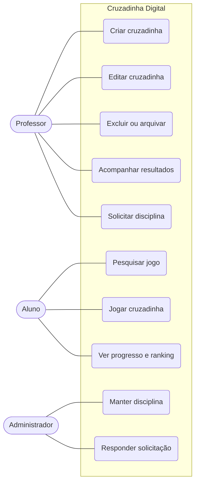

## 2. Acesso ao sistema

Abra o endereço da aplicação no navegador (no ambiente de desenvolvimento:
http://localhost:8080). Use um navegador atual (Chrome, Edge ou Firefox).

> **Versão atual:** a entrada pelo Lúdica ainda está em integração. Por
> enquanto, a tela de login permite **escolher um usuário cadastrado** e
> entrar como ele. Quando a integração estiver pronta, o usuário entrará
> direto pelo Lúdica, sem esta tela.

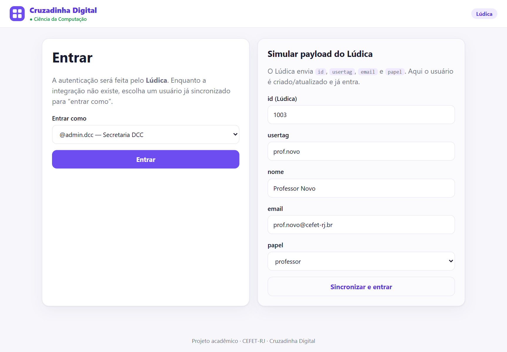

1. Em **Entrar como**, escolha o usuário (os usuários estão agrupados em Professores, Alunos e Administradores).
2. Clique em **Entrar**.
3. O sistema abre a tela inicial do seu perfil: professor → **Meus jogos**; aluno → **Buscar jogos**; administrador → **Disciplinas**.

O quadro **Simular payload do Lúdica** cria um usuário novo como se o Lúdica o
tivesse enviado (id, usertag, nome, e-mail e papel). Ele é útil para testes.

No topo de todas as telas aparecem o menu do seu perfil, o seu papel, o seu
usuário e o botão **Sair**.

## 3. Professor

### 3.1 Painel — Meus jogos

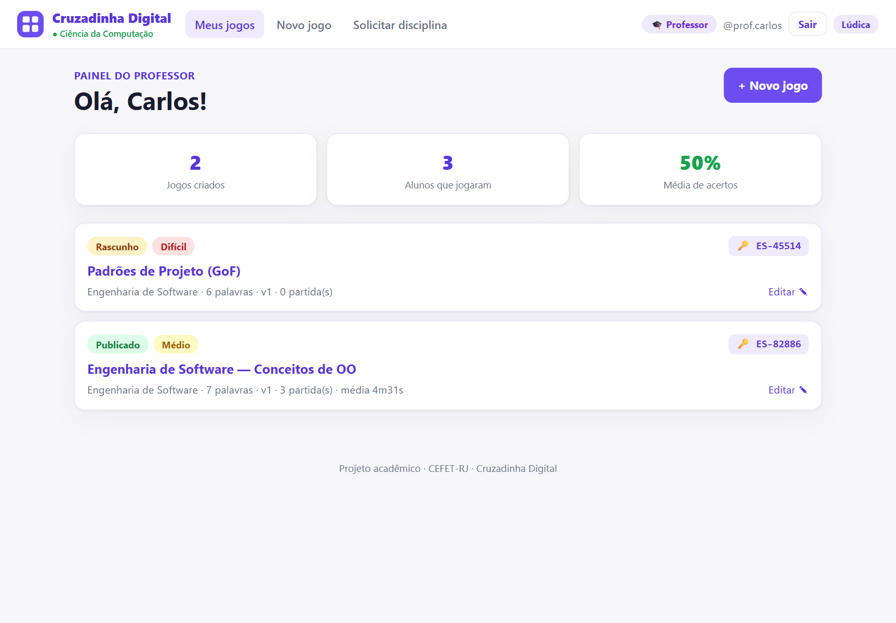

- **Jogos criados**, **Alunos que jogaram** e **Média de acertos** resumem os seus jogos.
- Cada cartão mostra o status (Rascunho, Publicado, Arquivado), a
  dificuldade, o **código de acesso** (🔑), a disciplina, o número de palavras,
  a versão, quantas partidas foram jogadas e o tempo médio.
- Clique no título para abrir o jogo, ou em **Editar ✎**.

### 3.2 Criar um jogo

1. Clique em **Novo jogo** (menu) ou **+ Novo jogo** (painel).
2. Preencha os **dados do jogo**:

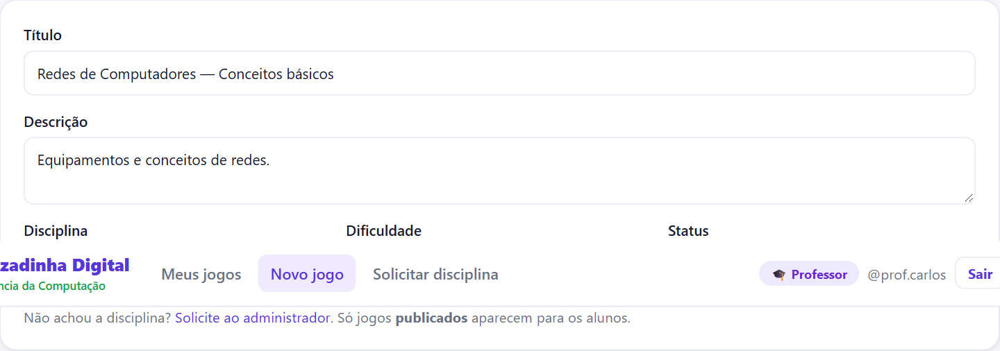

| Campo | Regra |
|---|---|
| Título | Obrigatório |
| Descrição | Opcional |
| Disciplina | Obrigatória — **uma única** disciplina por jogo. Só aparecem disciplinas ativas |
| Dificuldade | Fácil, Médio ou Difícil. Influencia a pontuação dos alunos |
| Status | **Rascunho** (só você vê) ou **Publicado** (aparece para os alunos) |

3. Cadastre as **palavras e dicas**, de **5 a 15** pares. Informe só a resposta
   e a dica: **o sistema decide onde cada palavra fica na grade**.

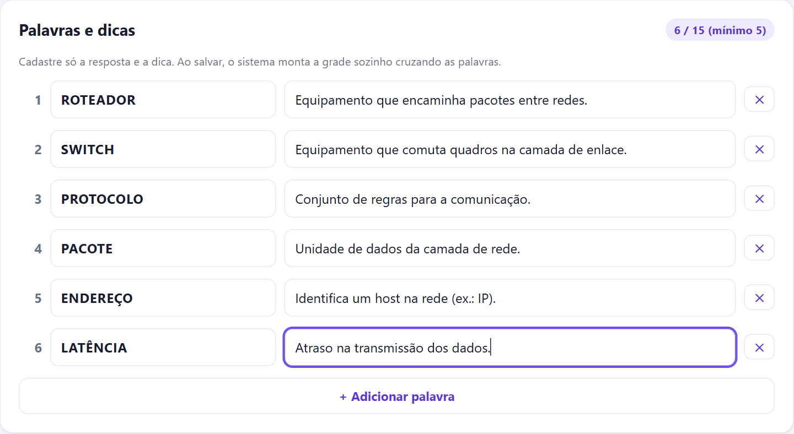

- O contador no canto mostra quantas palavras foram preenchidas (fica vermelho fora do limite).
- **+ Adicionar palavra** cria uma linha; **✕** remove.
- Acentos e espaços podem ser digitados normalmente: "Endereço" vira **ENDERECO** na grade.

4. Clique em **Salvar e gerar grade**. O sistema confere tudo e monta a
   cruzadinha. Se estiver tudo certo, abre o jogo criado (seção 3.3).

**Se algo estiver errado**, o jogo não é salvo e os problemas aparecem no topo
do formulário:

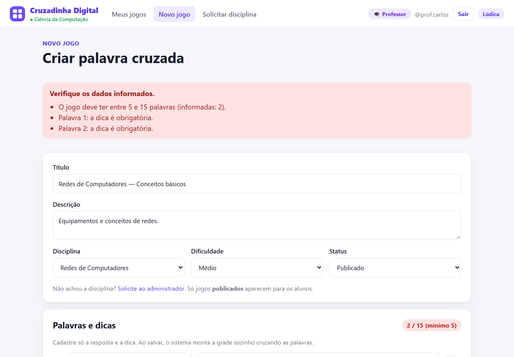

| Mensagem | O que fazer |
|---|---|
| "O jogo deve ter entre 5 e 15 palavras" | Adicione ou remova palavras |
| "Palavra N: a dica é obrigatória" | Preencha a dica dessa linha |
| "Palavra N: a resposta deve ter entre 2 e 20 letras" | Corrija a resposta |
| "Palavra N: … repete a palavra M" | Não repita respostas |
| "Não foi possível encaixar: XYZ" | Essa palavra não tem letras em comum com as outras e não cruza com nenhuma. Troque-a por outra |
| "Esta disciplina está desativada" | Escolha outra disciplina ou peça ao administrador |

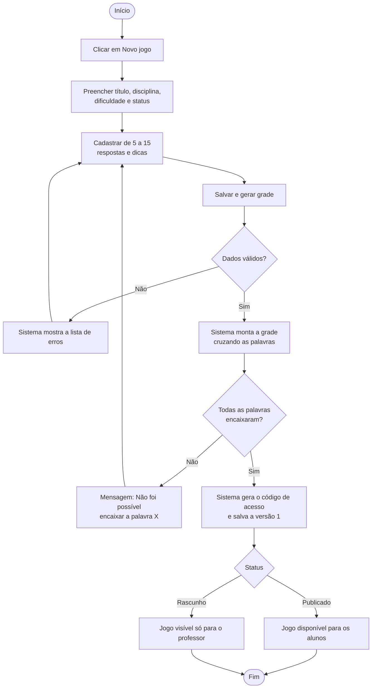

### 3.3 Ver o jogo (gabarito)

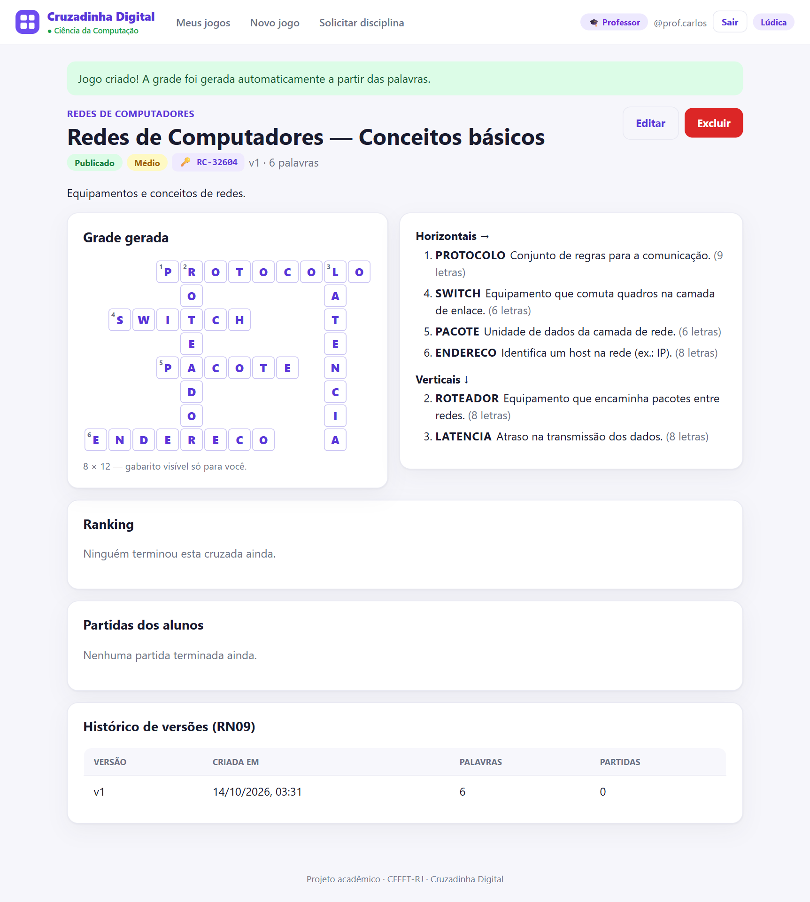

- **Grade gerada** com as respostas: o gabarito só é visível para o autor.
- **Horizontais** e **Verticais**: número, resposta e dica de cada palavra.
- **Código de acesso** (ex.: `RC-64110`): divulgue para os alunos encontrarem o jogo rapidamente.
- **Ranking**, **Partidas dos alunos** e **Histórico de versões** (seção 3.5).

### 3.4 Editar, publicar, arquivar e excluir

Clique em **Editar** no jogo: o mesmo formulário abre preenchido.

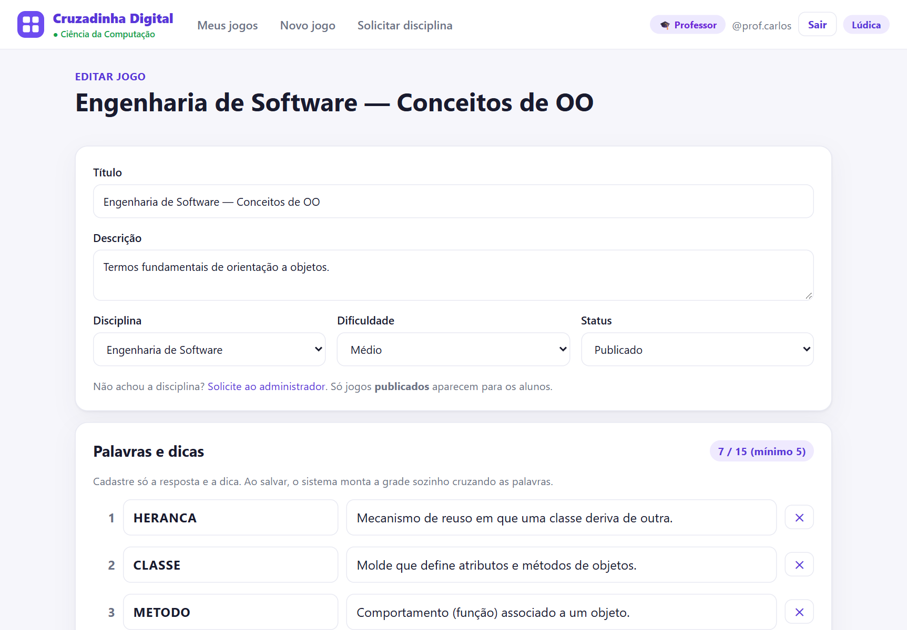

- **Mudou só título, descrição, disciplina, dificuldade ou status:** o jogo é
  atualizado na hora.
- **Mudou alguma palavra ou dica:** o sistema monta uma **grade nova** e cria
  uma **nova versão** (v2, v3…). As partidas já jogadas continuam ligadas à
  versão que os alunos jogaram, e o histórico não se perde.
- **Publicar:** mude o status para **Publicado**.
- **Arquivar:** mude o status para **Arquivado**. O jogo some da busca dos
  alunos, mas o histórico continua.
- **Excluir:** botão **Excluir** no jogo. Só funciona se **ninguém jogou**
  ainda. Se já houver partidas, o sistema pede para arquivar em vez de excluir.

### 3.5 Acompanhar os resultados

No jogo, abaixo da grade:

**Ranking** — a melhor partida de cada aluno, por pontos (no empate, vence o menor tempo):

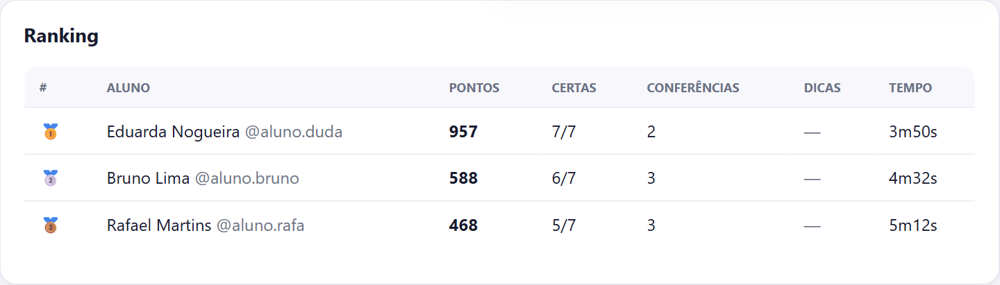

**Partidas dos alunos** — todas as partidas terminadas:

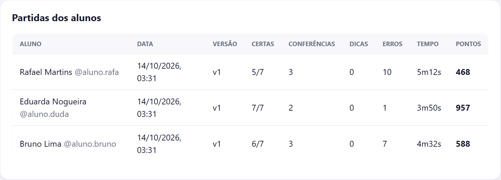

| Coluna | Significado |
|---|---|
| Certas | Palavras certas no fim / total |
| Conferências | Quantas vezes o aluno conferiu as respostas |
| Erros | Soma das palavras erradas em todas as conferências |
| Tempo | Do início ao fim da partida |
| Pontos | Pontuação final (seção 4.6) |

### 3.6 Solicitar uma disciplina nova

Se a disciplina que você precisa não existe:

1. Clique em **Solicitar disciplina** no menu.
2. Informe o nome, um código sugerido (opcional) e uma justificativa (opcional) e clique em **Enviar solicitação**.
3. Acompanhe em **Minhas solicitações**: o status muda para **aprovada** (a disciplina já aparece no formulário de jogo) ou **recusada**, com a mensagem do administrador.

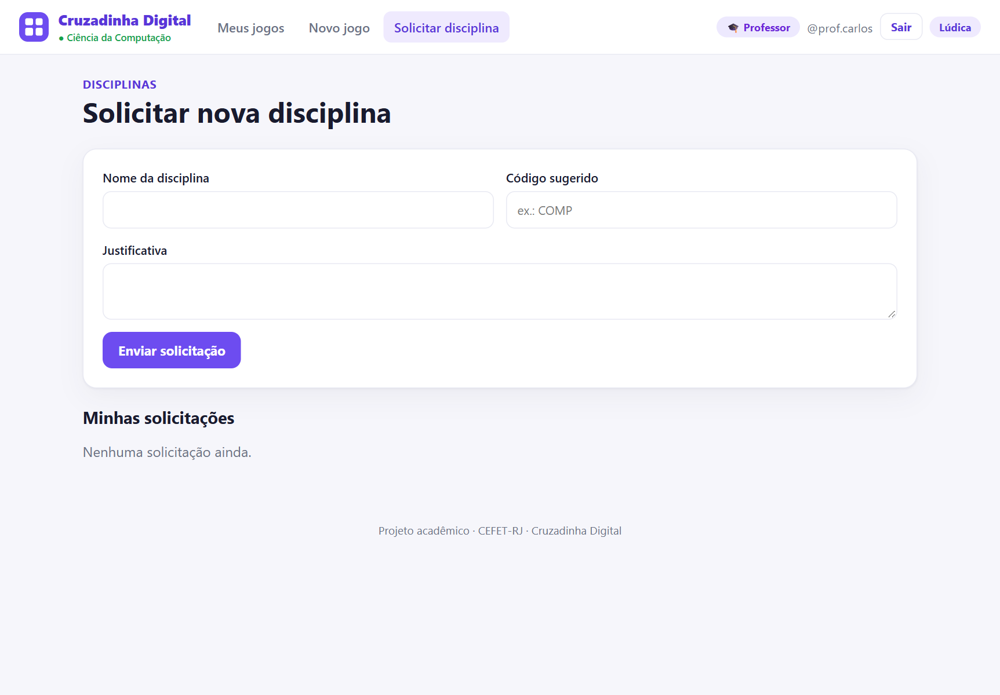

## 4. Aluno

### 4.1 Buscar jogos

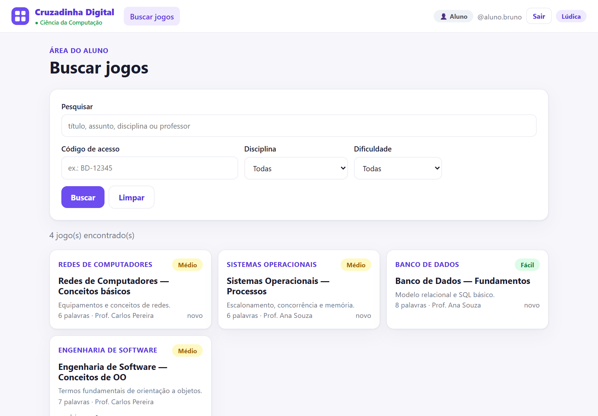

A tela lista os jogos **publicados**. Para filtrar:

| Filtro | Como funciona |
|---|---|
| Pesquisar | Procura no título, na descrição, na disciplina e no nome do professor |
| Código de acesso | O código que o professor divulgou (ex.: `RC-64110`) |
| Disciplina | Uma disciplina específica |
| Dificuldade | Fácil, Médio ou Difícil |

Clique em **Buscar**; **Limpar** remove os filtros. Cada cartão mostra a
disciplina, a dificuldade, o número de palavras, o professor e se você já
jogou ("você jogou 2×").

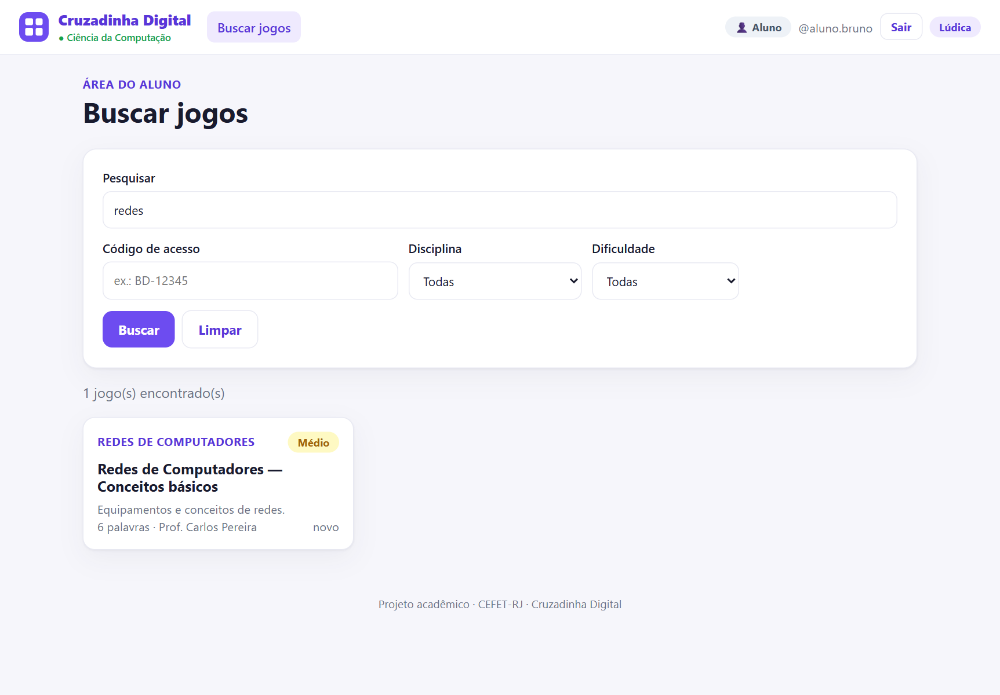

### 4.2 Página do jogo

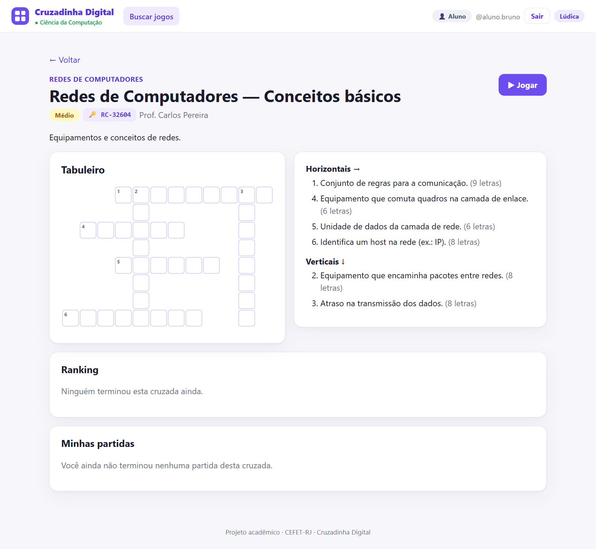

Antes de jogar você vê o tabuleiro **vazio** e as dicas, o **ranking** e as
**suas partidas** anteriores. O botão no topo mostra:

- **▶ Jogar** — primeira vez;
- **▶ Continuar partida** — você começou uma partida e não terminou;
- **↻ Jogar de novo** — você já terminou ao menos uma vez (pode jogar quantas vezes quiser).

### 4.3 Jogar

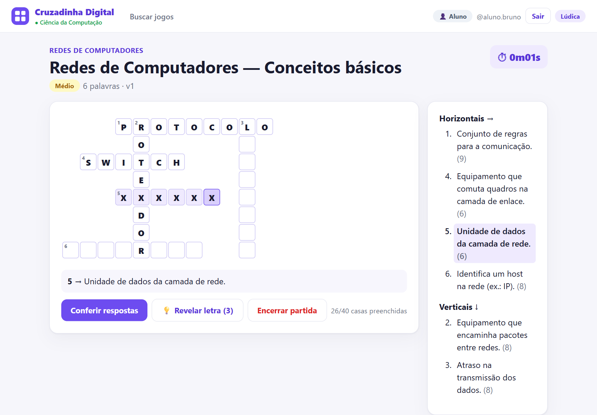

1. Clique numa **casa** da grade ou numa **dica** da lista: a palavra
   correspondente fica destacada e a dica aparece embaixo da grade.
2. Digite as letras. O cursor anda sozinho para a próxima casa da palavra.
3. Preencha quantas palavras quiser e clique em **Conferir respostas**.

| Tecla / ação | Efeito |
|---|---|
| Letra | Escreve e vai para a próxima casa |
| Backspace | Apaga a letra; se a casa estiver vazia, volta e apaga a anterior |
| Setas | Movem entre as casas |
| Clicar de novo na mesma casa | Troca entre a palavra horizontal e a vertical |
| Clicar numa dica | Vai para o início daquela palavra |

Acentos são ignorados: digitar "Ç" ou "C" dá no mesmo.

### 4.4 Conferir e terminar

Ao conferir, o sistema diz **quantas** palavras estão certas, **mas não quais**:

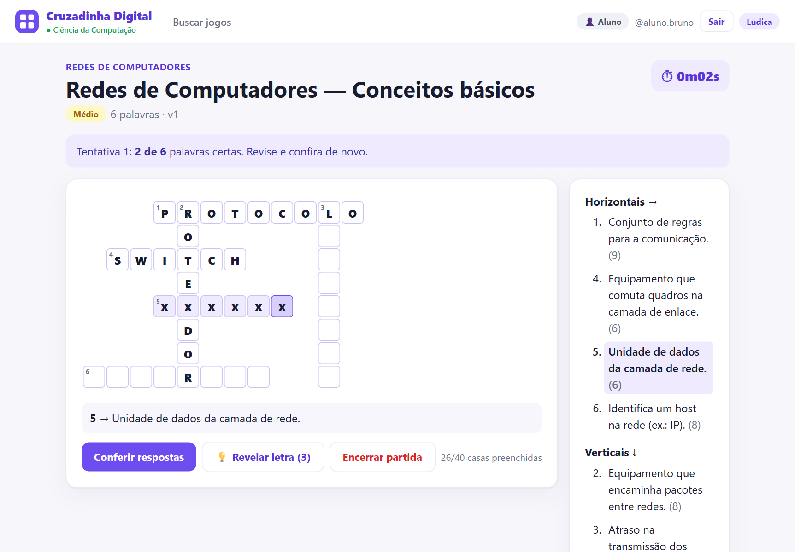

- Revise e confira de novo quantas vezes quiser. A lista **Conferências** mostra o resultado de cada tentativa.
- Quanto antes você acertar cada palavra, mais pontos ela vale (seção 4.6).
- A partida **termina sozinha** quando todas as palavras estiverem certas.
- **Encerrar partida** termina antes: vale o que estava certo na **última conferência**.
- Se sair da tela no meio, a partida fica guardada: na página do jogo aparece **Continuar partida**.

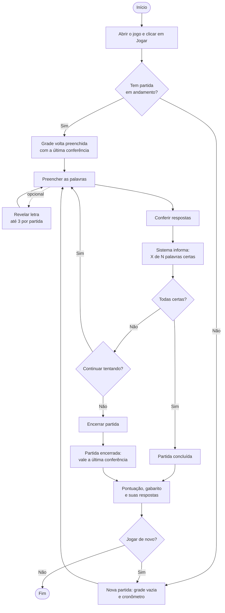

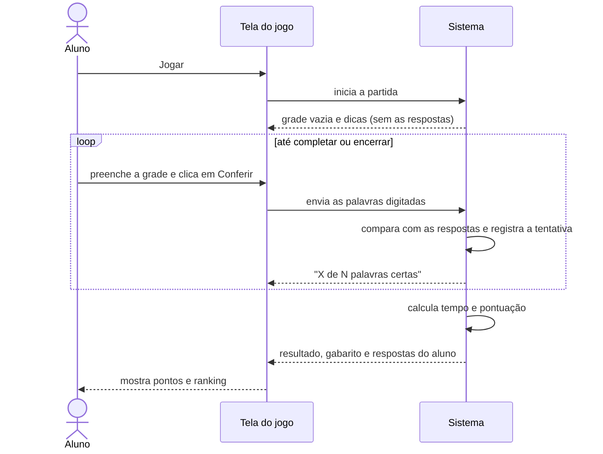

### 4.5 Dica: revelar letra

Travou numa palavra? Use a dica **💡 Revelar letra**:

1. Selecione a palavra (clique numa casa dela ou na dica da lista).
2. Clique em **💡 Revelar letra (N)**. O número entre parênteses é quantas dicas ainda restam.
3. Confirme. O sistema preenche a **primeira casa vazia** dessa palavra com a letra certa.

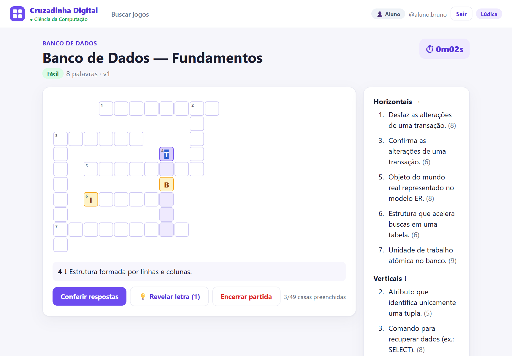

| Regra | Como funciona |
|---|---|
| Quantas | Até **3 dicas** por partida |
| Qual casa | A primeira casa **vazia** da palavra; se estiver toda preenchida, a primeira ainda não revelada. A dica nunca indica se o que você digitou está certo |
| Letra revelada | Fica com **fundo amarelo** e **travada**: não dá para apagar nem digitar por cima |
| Custo | Cada letra revelada tira **20%** dos pontos de **cada palavra que passa por aquela casa**. Num cruzamento, desconta das duas palavras |

Se você sair e continuar a partida depois, as letras reveladas continuam na grade.

### 4.6 Resultado e pontuação

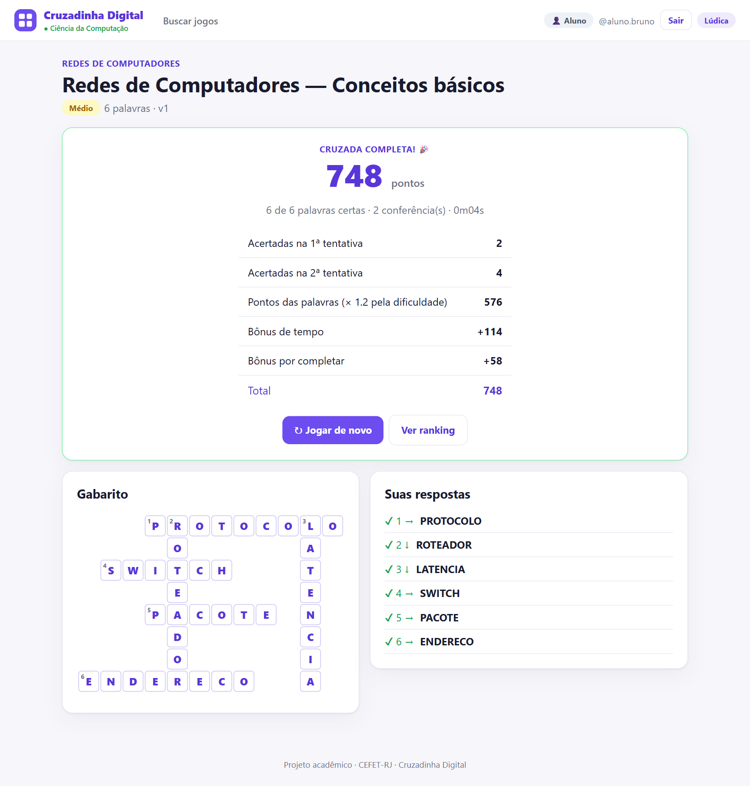

A pontuação é calculada assim:

**1. Cada palavra certa vale até 100 pontos**, conforme a conferência em que foi acertada:

| Acertou na | Vale |
|---|---|
| 1ª conferência | 100 |
| 2ª | 70 |
| 3ª | 50 |
| 4ª ou depois | 30 |
| Terminou errada | 0 |

Vale a conferência a partir da qual a palavra **ficou certa até o fim**. Se
você acertou, depois trocou e acertou de novo, conta a última vez.

**2. Multiplicador de dificuldade:** Fácil ×1 · Médio ×1,2 · Difícil ×1,5.

**3. Bônus de tempo:** até **+20%** para quem completa a grade, diminuindo
conforme o tempo passa (zera em 1 minuto por palavra).

**4. Bônus por completar:** **+10%** se todas as palavras ficarem certas.

**5. Desconto das dicas:** cada letra revelada tira **20%** dos pontos de cada palavra que passa por ela (seção 4.5). O resultado mostra o desconto numa linha própria:

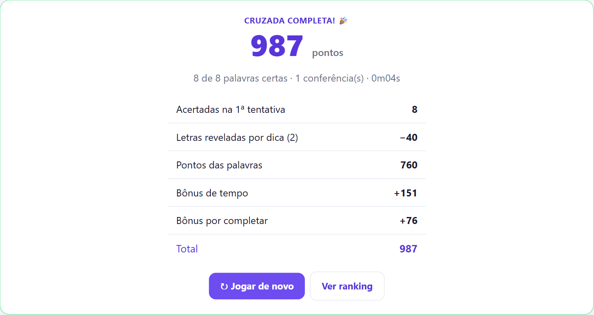

> **Exemplo:** jogo fácil com 8 palavras; 3 acertadas na 1ª conferência e 5 na
> 2ª → 3 × 100 + 5 × 70 = **650**; completou rápido → bônus de tempo **+129** e
> de completar **+65** → **844 pontos**.

O resultado também mostra o **gabarito** e, para cada palavra, se você acertou
e o que digitou. As respostas só aparecem **depois** de a partida terminar.

### 4.7 Ranking e minhas partidas

Na página do jogo:

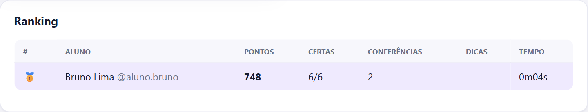

- **Ranking:** a melhor partida de cada aluno; a sua linha aparece destacada. 🥇🥈🥉 para os três primeiros.
- **Minhas partidas:** data, versão, tempo, conferências, palavras certas e pontos de cada partida terminada.

## 5. Administrador

### 5.1 Manter disciplinas

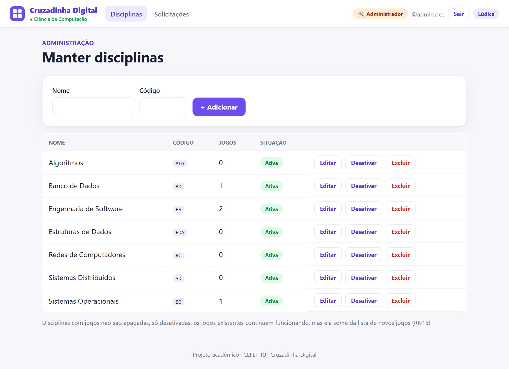

| Ação | Como |
|---|---|
| Incluir | Preencha **Nome** e **Código** e clique em **+ Adicionar**. O código vira maiúsculo e não pode repetir |
| Editar | **Editar** na linha → altere → **Salvar** |
| Desativar / Reativar | Disciplina **inativa** não aparece para novos jogos; os jogos existentes continuam funcionando |
| Excluir | Se a disciplina **não tem jogos**, é apagada. Se **tem jogos**, o sistema a **desativa** e avisa quantos jogos ela possui |

A coluna **Jogos** mostra quantas cruzadinhas usam cada disciplina.

### 5.2 Responder solicitações de disciplina

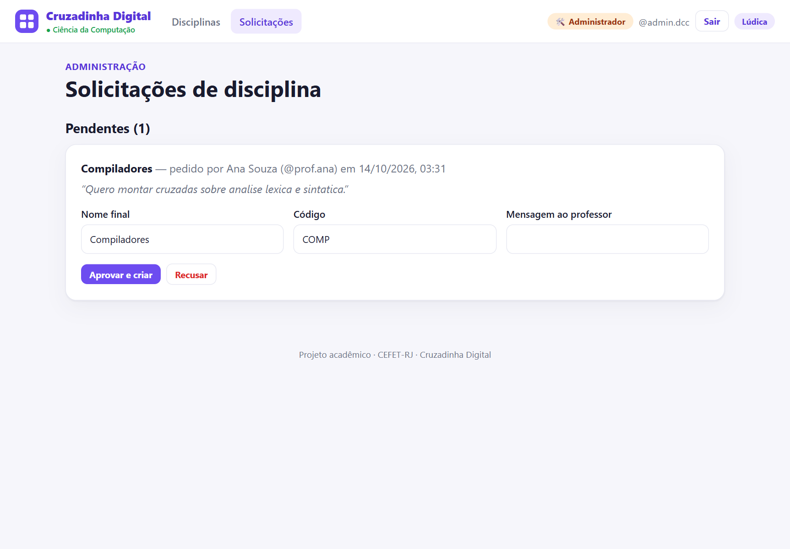

As solicitações **pendentes** aparecem primeiro, com o professor, a data e a justificativa.

- **Aprovar e criar:** ajuste o nome e o código finais, se quiser, escreva
  uma mensagem ao professor (opcional) e confirme. A disciplina é criada na hora.
- **Recusar:** escreva o motivo (opcional) e clique em **Recusar**.

As já respondidas ficam listadas embaixo, com quem respondeu e a mensagem.

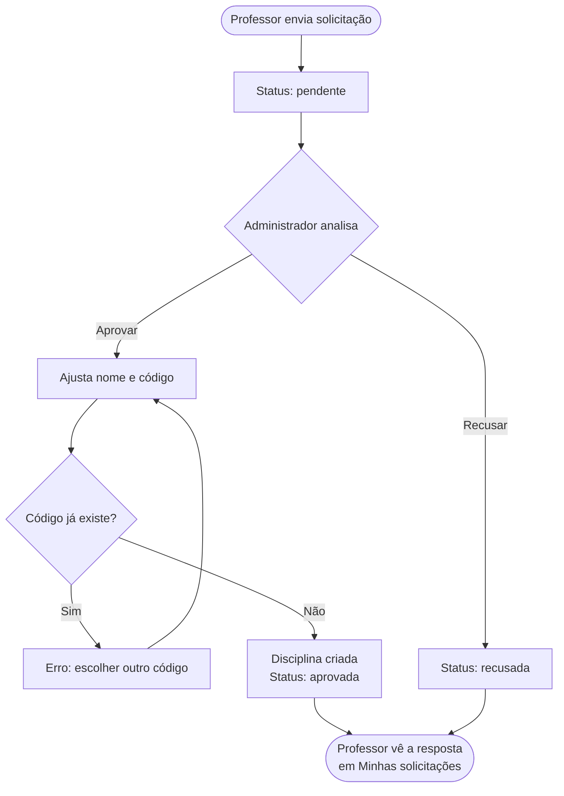

## 6. Principais regras de negócio

| Código | Regra |
|---|---|
| RN01 | Cada usuário tem um único papel: professor, aluno ou administrador |
| RN02 | Só professores criam cruzadinhas e as associam a uma disciplina |
| RN03 / RN08 | Só o professor autor pode editar ou excluir a sua cruzadinha |
| RN04 | Cada cruzadinha pertence a uma única disciplina |
| RN05 | Uma cruzadinha é formada por respostas e suas dicas |
| RN06 | Ao salvar, o sistema verifica se todas as palavras se encaixam na grade; se alguma não encaixar, o jogo não é salvo |
| RN07 | Dificuldade: fácil, médio ou difícil |
| RN09 | Editar as palavras cria uma nova versão; as partidas antigas continuam ligadas à versão jogada. Jogo já jogado não pode ser excluído, só arquivado |
| RN10 | O aluno pode jogar a mesma cruzadinha várias vezes |
| RN11 | As respostas não são mostradas ao aluno antes de ele terminar a partida |
| RN12 | Cada partida registra tempo, conferências, acertos, erros e pontuação |
| RN13 | Cada jogo tem de 5 a 15 palavras |
| RN14 | O professor cadastra só respostas e dicas; o sistema monta a grade |
| RN15 | Só o administrador mantém disciplinas; disciplina com jogos é desativada em vez de apagada |
| RN16 | O professor solicita disciplinas novas; o administrador aprova ou recusa |
| RN17 | O aluno só encontra jogos publicados |
| RN18 | O aluno preenche a grade e confere; o sistema informa quantas palavras estão certas, sem dizer quais |
| RN19 | A pontuação considera em qual conferência cada palavra foi acertada, a dificuldade, o tempo e se a grade foi completada |
| RN20 | O aluno pode revelar até 3 letras por partida; cada letra revelada desconta 20% de cada palavra que passa por ela |

## 7. Perguntas frequentes

#### Não encontro um jogo na busca.

Só aparecem jogos **publicados**. Confira com o professor se o jogo não está
em rascunho ou arquivado, ou peça o **código de acesso**.

#### Posso jogar de novo para melhorar minha pontuação?

Sim. O ranking considera a sua **melhor** partida.

#### Fechei a página no meio da partida. Perdi?

Não. Abra o jogo de novo e clique em **Continuar partida**. Mas atenção: o
tempo continua contando.

#### Posso pedir ajuda numa palavra?

Sim: selecione a palavra e use **💡 Revelar letra** (até 3 por partida). Cada letra revelada custa pontos (seção 4.5).

#### Por que o sistema não diz quais palavras estão erradas?

É a regra do jogo (RN18): você descobre pela contagem e pelas palavras que se
cruzam. Isso valoriza acertar logo na primeira conferência.

#### O professor mudou o jogo depois que eu joguei. Minha pontuação muda?

Não. Sua partida fica ligada à versão que você jogou.

#### Ao salvar um jogo aparece "Não foi possível encaixar".

Alguma palavra não tem nenhuma letra em comum com as outras, então não
consegue cruzar. Troque-a ou adicione palavras que tenham letras em comum com ela.

#### Por que não consigo excluir meu jogo?

Porque alunos já jogaram. Para não apagar o histórico deles, mude o status
para **Arquivado**.

#### A disciplina de que preciso não aparece.

Ela pode não existir ou estar desativada. Use **Solicitar disciplina**.

## 8. Glossário

| Termo | Significado |
|---|---|
| Cruzadinha / jogo | Uma palavra cruzada criada por um professor |
| Código de acesso | Código do jogo (ex.: `BD-27372`), usado pelo aluno para encontrá-lo |
| Versão | Cada conjunto de palavras de um jogo; editar as palavras cria uma nova versão |
| Partida | Uma vez em que o aluno joga uma cruzadinha |
| Conferência / tentativa | Cada vez que o aluno clica em "Conferir respostas" |
| Gabarito | A grade com todas as respostas |
| Rascunho / Publicado / Arquivado | Situação do jogo: em preparação, disponível para alunos, retirado da busca |
| Lúdica | Central de jogos educacionais que identifica os usuários |
