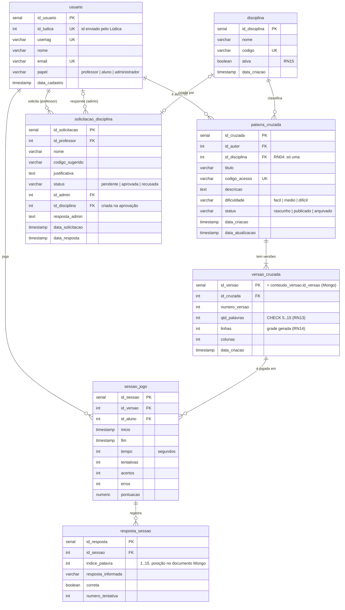

# Modelo de dados — Sprint 3

O sistema usa **dois bancos**:

| Banco | Guarda | Por quê |
|---|---|---|
| **PostgreSQL** | usuários, disciplinas, solicitações, cruzadas, versões, sessões de jogo e respostas | dados relacionais com integridade (FKs, `CHECK`) e consultas agregadas (painel, ranking) |
| **MongoDB** | o conteúdo de cada versão: palavras (resposta + dica) e a grade gerada | a versão é imutável (RN09) e sempre lida inteira — um documento por versão, sem JOIN |

A ligação entre os bancos é o `id_versao`.

Scripts: [`backend/db/postgres/schema.sql`](../backend/db/postgres/schema.sql) ·
coleção Mongo criada com `$jsonSchema` em [`backend/src/db/mongo.js`](../backend/src/db/mongo.js) ·
detalhes do Mongo em [`backend/db/mongo/modelo.md`](../backend/db/mongo/modelo.md).

**Coluna por coluna, com diagrama de cada tabela:** [dicionario-de-dados.md](dicionario-de-dados.md).

## PostgreSQL



## MongoDB — coleção `conteudo_versao`

```js
{
  _id: ObjectId,
  id_versao: 42,              // = versao_cruzada.id_versao  (índice único)
  id_cruzada: 7,              // = palavra_cruzada.id_cruzada (índice)
  grade: { linhas: 9, colunas: 12 },
  palavras: [                 // 5 a 15 itens
    { indice: 1, numero: 5, resposta: "HERANCA", dica: "...",
      linha: 5, coluna: 2, direcao: "horizontal" }
  ],
  criado_em: ISODate
}
```

## O que mudou em relação ao diagrama anterior

| Antes | Agora | Motivo |
|---|---|---|
| `usuario.senha` | removida; entram `id_ludica` e `usertag` | quem autentica é o Lúdica, que envia `id, usertag, email, papel` (Sprint 2) |
| `papel`: professor \| aluno | + `administrador` | perfil que mantém disciplinas (Sprint 3) |
| — | `disciplina.ativa` | disciplina com jogos é desativada, não apagada (RN15) |
| — | tabela `solicitacao_disciplina` | professor pede disciplina nova ao admin (RN16) |
| — | `palavra_cruzada.codigo_acesso` | código que o aluno usa para achar o jogo |
| tabela `palavra` (linha/coluna/direção digitadas) | sai do Postgres → documento no MongoDB, posições geradas pelo sistema | RN14 e uso do MongoDB (Sprint 3) |
| — | `versao_cruzada.qtd_palavras CHECK 5..15`, `linhas`, `colunas` | RN13 e dimensões da grade gerada |
| `resposta_sessao.id_palavra` → FK `palavra` | `indice_palavra` | a palavra agora mora no Mongo; como a versão é imutável, o índice nunca fica inválido |
| relação palavra ↔ resposta_sessao marcada 1:1 | 1:N | uma palavra recebe várias respostas |
| `pontuacao NUMERIC(5,2)` | `NUMERIC(7,2)` | 5,2 só vai até 999,99 |
