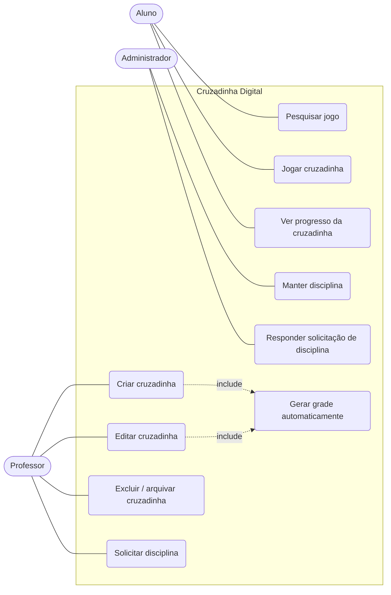

# Regras de negócio e casos de uso — v2 (Sprint 3)

Atualização do documento inicial (v1) com o que foi discutido nas Sprints 2 e 3.

## Atores

- **Professor** — cria, edita e exclui suas palavras cruzadas; associa cada uma a uma disciplina; solicita disciplinas novas.
- **Aluno** — pesquisa e resolve palavras cruzadas; acompanha seu progresso.
- **Administrador** — mantém o cadastro de disciplinas e responde às solicitações dos professores.

Os usuários vêm do **Lúdica**, que envia `id`, `usertag`, `email` e `papel` e é
responsável pela autenticação.

## Regras de negócio

### Cadastro e permissões
- **RN01** — Todo usuário possui um papel único: `professor`, `aluno` ou `administrador`.
- **RN02** — Apenas professores criam palavras cruzadas e as associam a uma disciplina.
- **RN03** — Apenas o professor autor pode editar ou excluir uma palavra cruzada criada por ele.

### Criação de conteúdo
- **RN04** — Uma palavra cruzada pertence a **apenas uma** disciplina.
  *(A v1 dizia na RN02 “uma ou mais disciplinas”, o que contradizia a RN04. Vale a RN04.)*
- **RN05** — Uma palavra cruzada é composta por um conjunto de palavras (respostas) e suas dicas.
- **RN06** — A montagem da grade é verificada ao salvar: se alguma palavra não puder ser encaixada cruzando com as demais, o salvamento é recusado e o professor vê quais palavras causaram o problema.
- **RN07** — Palavras cruzadas têm nível de dificuldade: fácil, médio ou difícil.
- **RN13** *(nova)* — Um jogo tem **no mínimo 5 e no máximo 15 palavras**.
- **RN14** *(nova)* — O professor cadastra **apenas respostas e dicas**. O sistema gera automaticamente a grade (linha, coluna e direção de cada palavra).

### Edição
- **RN08** — Uma palavra cruzada só pode ser editada por seu autor.
- **RN09** — Editar as palavras de uma cruzada cria uma nova versão; as tentativas já registradas continuam vinculadas à versão jogada. Uma cruzada que já foi jogada não pode ser excluída — deve ser arquivada.

### Disciplinas
- **RN15** *(nova)* — Apenas o administrador cria, edita e exclui disciplinas. Disciplina que já tem jogos não é apagada, só desativada, e deixa de aparecer para novos jogos.
- **RN16** *(nova)* — O professor pode solicitar uma disciplina nova; a solicitação aparece para o administrador, que aprova (criando a disciplina) ou recusa.

### Jogo
- **RN10** — Um aluno pode jogar a mesma palavra cruzada múltiplas vezes.
- **RN11** — O sistema não exibe as respostas antes de o aluno tentar resolver a palavra cruzada.
- **RN12** — O sistema registra tempo gasto, número de tentativas e acertos/erros por sessão de jogo, para acompanhamento, pontuação da partida e ranking dos alunos.
- **RN17** *(nova)* — O aluno só encontra na busca jogos com status **publicado**, podendo filtrar por texto, código de acesso, disciplina e dificuldade.

## Diagrama de casos de uso

## Situação por sprint

| Item | Situação |
|---|---|
| Modelo PostgreSQL + MongoDB | ✅ ver [modelo-de-dados.md](modelo-de-dados.md) |
| Front-end React / back-end Node | ✅ `frontend/` (React + Vite) e `backend/` (Node + Express) |
| Perfil administrador — Manter Disciplina | ✅ |
| Mínimo e máximo de palavras | ✅ 5 a 15 (RN13) |
| Grade gerada pelo sistema | ✅ professor cadastra só resposta + dica (RN14) |
| Aluno pesquisar jogo | ✅ busca + página do jogo (sem respostas) |
| Solicitação de disciplina → administrador | ✅ (estava como “futuro”) |
| Aluno resolver o jogo, pontuação e ranking | ⏳ próxima sprint (tabelas já existem) |
| Login integrado ao Lúdica | ⏳ a definir — hoje o login é simulado |
